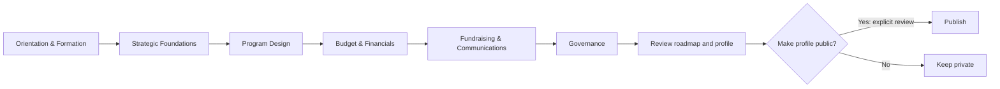

# Workspace AI, Accelerator graphs and credits

Date: 2026-10-22. **Implementation in progress; commercial policy remains proposed.**

Authoritative checkpoint for this planning slice. Companion: [rewritten prompt](2026-10-22-workspace-ai-prompt.md).

## 1. Recommendation and scope

Build an objective-led planning workspace for any organizational task. Objectives describe desired outcomes; each objective owns editable plans of steps, decisions, branches and linked resources. A compact Objectives island at the canvas top center expands into objective cards and inline plan checklists. The canvas projects those same plans as editable trees. Related plans display their explicit connections; unrelated plans remain separate trees. Funding discovery is an optional capability within a plan, not the organizing purpose of the product.

Reuse the canvas, document editor and saved-data owners. AI proposes plans and revisions; people approve changes; deterministic code enforces permissions, curriculum rules and money.

The first usable slice is: **select a core document → ask for help in the composer → see a streamed proposal and its credit cost → accept into the existing editor → save and reopen it.** This proves the same foundation later used for decision trees and resource matching.

| Approach | Trade-off | Decision |
| --- | --- | --- |
| AI SDK plus selected shadcn chatbot patterns inside Coach House | Reuses streaming/tool UI while retaining our data and design contracts | Recommended |
| Direct OpenAI SDK with custom chat transport | Fewer new packages; more streaming, typed-message and tool-state work | Viable fallback if compatibility fails |
| Replace workspace with a standalone chatbot/agent application | Duplicates navigation, persistence and permission boundaries | Reject for this scope |

The supplied framework asks for depth: the critical work is trustworthy state changes, correct billing and evidence-backed outputs, not a larger agent platform. Instinct, new external connectors, autonomous applications/outreach, image/audio generation and broad nonprofit acquisition are deferred.

### Evidence and authority

Inspected source at `5644ccc34cbbfc7ed3b94e77d409e4e12c0202e4` on `feat/particle-system-20261009`, initially clean and tracking its matching remote branch. The main checkout is a different worktree; it is not the implementation target. Original workstream08 is background context; this newer request selects planning in the existing redesign lane instead of its old isolated-main implementation sequence. Shared SHIP records and other lanes remain unchanged.

Inputs: the supplied framework, all six screenshots, the complete two-version curriculum text, current code, original packet 08, existing Particle/Workspace Engine/objective plans and current official provider documentation. Earlier plans contain historical architecture and interaction details; current source and newer user directions take precedence.

No boards were cleared, runtime code changed, services purchased or production data modified. The separate Brand Identity migration remains pending its own approval; this plan does not apply it.

## 2. Existing system and integration points

| Area | Verified current source | Planned reuse / missing piece |
| --- | --- | --- |
| Composer | `src/features/workspace-particles/components/particle-composer.tsx` | Search/create parser exists; conversational AI does not |
| AI | `src/app/api/ai/sql/route.ts`; `openai` dependency | Management SQL generation only; never expose its privileges to members |
| Canvas | `src/features/workspace-particles/lib/{particle-schema,graph-operations,graph-validation,graph-layout,particle-decision}.ts` | Typed particles, decisions, operations, replay receipts and validation; add reviewed AI proposals |
| Board saves | `src/app/(dashboard)/my-organization/_lib/workspace-board-state-write.ts` | Preserve compare-and-swap and named-workspace merging |
| Accelerator | `src/features/workspace-accelerator-card/{types.ts,lib/checklist.ts}` | Existing module/step state and embedded lesson navigation; add curriculum graph projection |
| Objectives | `src/features/workspace-objectives/types.ts`; `src/app/(dashboard)/my-organization/_lib/workspace-objectives-actions.ts` | Existing relational groups, objectives, assignments and links; reconcile numeric particle state |
| Documents | `src/features/document-editing/**`; `src/components/roadmap/**`; `src/components/rich-text-editor.tsx` | Existing room permissions, Tiptap/Yjs and save/recovery contracts; adapters differ by document type |
| Opportunities | `src/features/workspace-finance/{types.ts,lib/opportunity-ingestion.ts,server/opportunities.ts}` | Existing opportunities lack the complete amount/eligibility/evidence/resource-match model |
| Billing | Existing Stripe checkout/webhook and coaching ledger | Reuse payment/session conventions; add a separate AI ledger and reservations |

Current package declarations include Next 16.4, React 19.2, React Flow 12.12, Tiptap 3.16, Zod 4, OpenAI 6.25 and Stripe 18.5. No `ai`/`@ai-sdk/*` packages are installed. Confirm lockfile compatibility at implementation, without upgrading the app framework incidentally.

### shadcn chatbot template

Use its typed message-part rendering, streaming status, `ask_user` questionnaire and source-list pattern. Preserve the MIT notice for copied source. It is a useful reference, not a replacement app. [Template](https://github.com/shadcn-ui/chatbot-template)

The inspected manifest uses AI SDK 7, `@ai-sdk/react`4, `@shadcn/react`, Base UI, React 19.3 and Next 16.3.6. Adapt needed primitives to our established components; verify peer dependencies and pin a reviewed revision. Do not copy its package file or globally replace Radix-based controls. [Manifest](https://github.com/shadcn-ui/chatbot-template/blob/main/package.json)

Its chat route validates messages and bounds model steps/output but is public and has no Coach House billing or organization authorization. Build our route around those missing controls. Do not inherit demo tools, arbitrary model selection or unrestricted reasoning displays. Show concise work status and evidence instead. [Route](https://github.com/shadcn-ui/chatbot-template/blob/main/app/api/chat/route.ts)

AI SDK is the application toolkit; AI Gateway is optional provider routing/billing infrastructure. Neither supplies our customer wallet. Start with one provider behind the SDK; evaluate Gateway only against actual routing, retention and cost needs. Current official SDK documentation is v7. [AI SDK](https://ai-sdk.dev/docs/introduction)

## 3. User journeys and UI

### Composer and documents

Keep the current bottom composer and existing window convention. Deterministic search/add commands remain free. Provide an explicit AI action/mode so ordinary library searches do not unexpectedly spend credits. Show removable context chips for the selected organization, resource and document/selection. Private files are included only after authorization and deliberate selection.

1. User opens a document or selects a resource and asks a question.
2. Composer shows relevant context and a maximum credit charge before a metered run. One compact clarifying question appears only if the target or needed facts are missing.
3. Stream into a draft preview, not the live document or graph. Show Stop and a stable status; do not shift the whole canvas on each token.
4. Offer Apply, Revise and Discard. For document changes show target, insertion/replacement scope and comparison. Applying without another generation costs no additional credits; Revise is a new priced run.
5. Apply through the document's real editor transaction and save contract. Show Saved only after canonical acknowledgment. Reopen proves persistence.

Start with core documents already edited in the workspace. Expand to notes and supported uploaded documents only through their own adapters. Do not claim unsupported Google Drive editing. Recheck target permission and version on Apply; a changed document produces a comparison/review state, never a silent overwrite. Generated content stays private/draft and uses existing sanitization. In collaborative editors, use native editor transactions, not whole-document HTML replacement.

### Selection assistance — October 22 reference update

All supported editable Tiptap surfaces should expose a compact floating selection toolbar matching the supplied reference: **Ask for changes**, link, bold, italic and the relevant text/list style. Reuse the shared editor and existing formatting commands; neutral light/dark tokens, keyboard access, touch targets and reduced motion. Show it for a nonempty text selection; avoid another permanent toolbar, nested dialog or duplicate chat interface.

Ask for changes must retain the selected range and document identity, open the existing request/review experience, and show the selected scope before charging. Keep proposed text separate until explicit Apply. Replace only that range through the live Tiptap transaction, preserving surrounding content, formatting, undo and collaboration. Reject stale or ambiguous selections after document/collaborator edits; never silently expand a selection edit into whole-document replacement. Revisions, cancellation, recovery and credit limits reuse the current AI contracts.

This applies to core documents, organization story editors, notes and supported uploaded-document editors through each existing save/permission adapter. A generic button connected only to core documents does not satisfy the request. Read-only views must not expose mutation controls. No production activation is implied. Provider verification still requires the pending local key/model/tariff configuration.

### Shared states

| State | User behavior |
| --- | --- |
| Empty | Small task suggestions tied to selected context; no invented organization facts |
| Working | Clear bounded status, streaming preview and Stop |
| Clarification | One concise question; resume same run/context with validated answer |
| Ready | Review proposal, sources, cost and affected target |
| Stale/conflict | Preserve proposal and current edits; compare or regenerate |
| Insufficient credits | Preserve input; show remaining balance, reset date and permitted purchase action |
| Failed/interrupted | Retain draft/input; show final charge or pending reconciliation; retry with an explicit new request |
| Permission changed | Stop reading/applying protected content; preserve only what the user may still access |

Use the app's compact rounded cards, pills, restrained borders and light/dark/system tokens. Avoid extra explanatory boxes. Keep keyboard focus visible only when appropriate, touch targets 44px, contextual actions labeled, and live announcements restrained. Honor existing pan/Shift-selection behavior. Motion uses existing transform/opacity transitions, supports interruption and reduced motion. Provide a keyboard-accessible list equivalent to graph navigation. User visual review precedes visual-baseline updates.

## 4. Optimized Accelerator graph

The curriculum is deterministic, versioned content. AI may explain or recommend a next step; it cannot rewrite required questions or infer completion.

| Stage | Groups | Lessons | Questions |
| --- | --- | ---: | ---: |
| Orientation & Formation | Introduction; Formation | 5 | 0 |
| Strategic Foundations | Strategic Foundations; Mission, Vision & Values; Theory of Change & Systems Thinking | 9 | 91 |
| Program Design | Piloting Programs | 4 | 20 |
| Budget & Financials | Budgets; Intro to NFP Financials | 6 | 13 |
| Fundraising & Communications | Fundraising; Communications | 11 | 58 |
| Governance | Boards that make a difference | 6 | 4 |
| **Total** | **11 groups** | **41** | **186** |

Retain all 28 question-list and 20 output-list cards. Questions and input types come unchanged from Version 1, nested by Version 2's order. The Markdown lacks stable IDs and a complete machine-readable output mapping: reconcile it with the original flow export and current assignments before generating a manifest. Fail the reconciliation on missing/duplicate IDs; do not fuzzy-match titles into silent writes or add hidden lessons to this 41-lesson view.

Default canvas: six compact stage cards. Expand a stage to groups/lessons; expand a lesson to question/output cards. Open content in the existing workspace window. Collapse only hides a projection, preserving records, answers, edges, completion and drafts. Keep expansion/viewport preferences personal; changes by another collaborator must not collapse a user's active editor. Re-layout only the affected managed region and discard stale worker results.



Arrows above show suggested learning order, **not access locks**. Entry is the current paid-member signup/workspace/profile journey; do not restore removed intent/community onboarding steps.

| Relationship | Meaning |
| --- | --- |
| Contains | Stage/group/lesson hierarchy |
| Suggested next | Recommendation; user may skip/open other lessons |
| Updates | Existing explicit answer-to-profile/roadmap mapping |
| Related | Reference only; no automatic save |
| Decision outcome | One declared outcome chosen by the user/rule |
| Dependency | Genuine, separately defined requirement |

Current graph relationships do not express all these distinctions. Add a versioned projection/adapter instead of encoding curriculum order as blocking dependencies. Need Statement, Mission, Vision, Values, Theory of Change and pilot mappings must retain their existing authoritative save rules. Publishing remains separate from lesson completion.

### Safe board adoption

First preview with fictional local fixtures and a new development workspace. New-user starters can later use the versioned template. Existing users get an opt-in preview with a recoverable layout snapshot and retained IDs; adoption changes presentation without deleting underlying lessons, documents, custom resources or named workspaces. A future destructive replacement requires a separately reviewed exact scope. Rollback restores layout without rolling back legitimate intervening answers/document edits. Unknown schema data is preserved, never normalized into an empty board.

## 5. Objectives and synchronized plans — October 22 priority clarification

The user's resumed direction supersedes the earlier funding-oriented framing and linear delivery order. Preserve the completed document-assistance slice; make the objective-to-plan journey the next visible implementation milestone. Authenticated runtime proof remains a release gate, not an open-ended prerequisite to building the requested planning experience.

### Interaction contract

- **Objective:** an editable desired outcome in the existing normalized objective collection. Examples include launching a program, recruiting volunteers, planning an event, improving governance or raising funds. Do not limit prompts/templates to funding.
- **Plan:** one or more editable approaches attached to an objective, with ordered actions, decisions, named outcomes and linked documents/resources. The user can create and change them manually; AI proposals use the same model after review.
- **Compact surface:** a rounded, Dynamic Island-style Objectives control at the top center of the existing canvas. Expand into compact objective cards with concise progress, status and accessible show-more controls. Avoid a separate dashboard or permanent large panel.
- **Checklist view:** expanding an objective reveals its plan steps and branches inline. Decision alternatives are labeled and distinguishable; a flat list must not falsely imply all alternatives are required. Plan selection is available when an objective has multiple plans.
- **Canvas view:** selecting a plan shows its tree using the existing graph engine. The checklist and graph share stable step IDs and canonical records; edits/completion in either view update the other after acknowledgment and survive reload.
- **Related plans:** explicit, authorized relationships connect plans and expand their visible graph. Shared steps keep one identity. Unrelated plans display as separate trees; mere visual proximity or an AI guess does not merge records.
- **Progress:** show actual applicable completed work; optional, unselected and unknown branches do not inflate or falsify completion. Keep learning, work and evidenced outcomes distinct.
- **Preservation:** collapsing/switching hides a projection only. It cannot delete plans, answers, graph positions, collaborators' edits or pending drafts. Views remain useful when AI is disabled.

Visual references: the user supplied a compact timeline/menu, expandable onboarding checklist, connected branch diagram and rounded segmented-progress card. Registry references are `https://lab.xevrion.dev/r/onboarding-checklist.json` and `https://lab.xevrion.dev/r/dynamic-island.json`. Inspect before adapting; preserve existing shadcn/Radix primitives, neutral light/dark tokens, keyboard support and reduced motion. Do not copy unrelated demo actions or install over shared components.

### Next reviewable milestone

Create an objective → add/edit a manual plan → expand its checklist → show/edit the same steps on the canvas → update status → reload. Demonstrate a related pair and an unrelated plan without duplicated records. Stop for a visible checkpoint at that boundary; report any remaining AI, billing, curriculum, matching or authenticated-runtime gates separately. Do not call a disconnected mock or schema-only change this milestone.

### Sprint completion criteria

1. The objective/checklist/tree journey above works with permissions, reliable saving and collaboration/conflict handling.
2. AI creates and revises general-purpose plans as reviewed proposals, with validated/idempotent application and user-editable results.
3. Metered document assistance, usage, purchases, limits and opt-in capped refill work as specified; proposed policy stays configurable pending approval.
4. The expandable Accelerator retains the full curriculum, answers and completion, and links into objectives/plans without replacing canonical records.
5. Relevant plans can invoke resource-specific funding discovery with verified sources, honest eligibility and amounts. Funding is not required for every objective.
6. Resource terminology, accessible responsive UI, tested failure recovery and development-branch checkpoints are complete. Production migration, live billing, merge/deploy and appearance acceptance remain separately authorized gates.

The remaining sections retain their security, persistence and evidence contracts.


### Decision trees

Example user intent: “Help plan funding for our summer pilot.” AI asks for missing target/context, then proposes a small graph with decisions, named outcomes, resources and next actions. Every consequential conclusion includes supporting facts or a visible assumption. An unknown fact produces “Needs information,” not an invented answer.

Return a bounded structured proposal: node type/title/context references, declared decision outcomes, typed edges, source IDs and explanation. Server assigns/binds IDs and checks schemas, cross-org references, cycles, limits and permissions. No arbitrary JavaScript predicates, SQL, executable components or model-directed network destinations. Current decision outcomes do not constitute a generic rules engine. Add only a small typed predicate vocabulary if an approved slice needs automatic evaluation.

Preview proposed changes before accepting an atomic operation batch through existing graph writers. Persist application idempotency beyond the graph's 64-entry replay receipt window. Retry does not duplicate cards; undo does not overwrite someone else's subsequent work. AI generation never marks a lesson complete or sends an application. Start with one authoritative target per proposal. If a later proposal spans objective records and graph projections, use an authorized transactional command or durable reconciliation state; do not claim atomic success across unrelated writers after a partial save.

### Objective tracker PRD

**Outcome:** users know their next action, its owner and why it matters, while distinguishing learning progress from real organizational results.

Compact view: title, status, owner, due date, linked resource and a truthful progress indicator. Detail in the existing window: desired outcome, target/current/unit, milestones, evidence, source document/lesson, dependencies and history. Filters: workspace/resource, mine, due soon, blocked, completed. Open lesson links inside the workspace rather than navigating away.

Use current relational objective IDs/groups/assignees/source keys as canonical task identity. Reconcile particle target/current/unit into that model with additive metric/history fields; particle cards become projections referencing those IDs. Do not create a third objective store. Existing source keys prevent duplicate derived tasks. Completion comes from current source rules or an explicit permitted user action, not from reading a lesson, accepting AI text or elapsed time.

Keep three kinds of progress distinct:

- Learning: completed applicable lessons/steps, using existing rules.
- Work: completed milestones/total applicable milestones.
- Outcome: evidenced current/target in the same unit; no percentage when target is missing/zero.

Funding examples show potential, awarded/committed and received separately. An opportunity being saved or applied to changes workflow status, not money received. Deduplicate linked awards before aggregation. AI can propose a milestone breakdown; user acceptance creates records once.

## 6. Resources and opportunity matching

Rename workspace labels **Activity → Resource**, **Activities → Resources**, **Add activity → Add resource**, including menus, library, search hints and accessible names. Keep stored `activity`, UUIDs, `activityId`, widget storage and API contracts initially. Preserve genuine audit/activity-history language and distinct public resource-directory terminology. Add “activity” search aliases for older users. A storage rename would be a separate versioned migration.

### Card and detail

Adapt image 1: compact fit strip, amount/range, title, two-line summary, provider/location, deadline and a few useful tags. Save and dismiss controls have accessible names and undo. Detail exposes “Why this fits,” unmet/unknown criteria, source, last verified date and the target resource. Save is not Apply; preparing an application opens a draft workflow, never submits it.

Use qualitative fit labels initially. A future numeric fit score requires a documented rubric and calibration; it must never be labeled as probability of winning. Deterministic eligibility is pass/fail/unknown for each published criterion. AI may extract candidate facts and explain them; missing facts remain unknown.

### Dollar-value contract

Always attempt value resolution in this order: structured award fields → original notice/attachments → funder's official page. Cap retrieval effort and report missing values honestly.

| Evidence | Display / calculation |
| --- | --- |
| Published per-award amount/range | Show currency, bounds, period and source |
| Published maximum only | “Up to $X”; never present it as expected proceeds |
| Total funding pool | Label as program total; do not imply it is one applicant's award |
| In-kind quantity with defensible value source | Show quantity; optional cash-equivalent estimate with method/date/source, separately from cash |
| No reliable amount | “Amount not published”; retain source and verification date |
| Resource need/budget missing | Ask for target/remaining need; do not invent a funding gap |

For comparable currency/period and eligible costs, `potential_coverage_max = min(published_per_award_cap, eligible_unfunded_resource_cost)`. A published minimum exceeding the user's eligible request may mean ineligible; do not silently clip it. Account for restricted costs, matching-fund requirements, cost share and overlap. Example fixture: a $25,000 eligible unfunded pilot and an award of up to $10,000 can show “Up to 40% of this gap,” not “$10,000 secured.” Foreign currency requires a dated rate/source or stays in source currency. No expected-value multiplication by an uncalibrated fit score.

### Data and sources

Extend existing opportunities with canonical provider/external ID, original URL, posted/updated/discovered/verified times, deadline/timezone, status, award floor/ceiling/currency/period, funding pool, cost-share rules, eligibility facts and field-level evidence. Store per-resource matches separately with resource revision, criteria outcomes, explanation, value calculation and ranking version. Deduplicate by provider ID and canonical notice; distinguish amendments from new awards. Private organization matching data stays private.

Start with a bounded US pilot using official grant sources and user-supplied funder URLs. Grants.gov search plus detail APIs expose opportunities and award fields; federal coverage alone is not a comprehensive local-foundation feed. Add other official funders only with supported access and provenance. [Grants.gov search](https://www.grants.gov/api/common/search2), [opportunity detail](https://www.grants.gov/api/common/fetchopportunity)

Simpler.Grants.gov also offers search/detail access; it currently documents read-only APIs. Compare its schema/access and duplication with Grants.gov before choosing one primary adapter, rather than ingesting both as separate awards. [Developer documentation](https://simpler.grants.gov/developers)

“Last 7 days” means source posted/updated time, with discovered time stored separately. Refresh before applying; flag stale or withdrawn results and exclude expired opportunities from active matches. Start on demand; scheduled feeds/notifications require a later explicit user-facing subscription and budget policy.

## 7. Runtime and persistence contract

```mermaid
sequenceDiagram
  participant U as Workspace user
  participant A as Authorized AI service
  participant L as Credit ledger
  participant M as Model/tools
  participant W as Existing writers
  U->>A: Intent + allowed target IDs + request ID
  A->>A: Resolve actor, org, permissions, revisions
  A->>L: Reserve bounded maximum atomically
  A->>M: Limited context and allowlisted tools
  M-->>U: Draft/status through validated stream
  M-->>A: Final output and usage
  A->>L: Settle once; release unused reservation
  A-->>U: Validated proposal + sources + actual charge
  U->>A: Apply proposal
  A->>A: Reauthorize + verify source revisions
  A->>W: Idempotent domain operation
  W-->>U: Saved version/operation receipt
```

New feature boundaries: `workspace-ai` for runs/context/tools/proposals; separate `ai-credits` for accounting/payment policy. Scaffold only when implementation begins. Reuse existing objective/finance features and add a curriculum projection within the Accelerator feature. Routes remain composition-only.

Private records needed: AI runs, bounded messages, proposals, billing accounts, grants/purchase lots, reservations and append-only ledger entries. Run metadata includes actor/org/workspace, request ID, input revisions, task/model, policy version, usage/cost, proposal and operation receipt. Strict RLS plus server authorization; organization context is never trusted merely because the client or model supplied it. Do not place private context or drafts in public profile JSON.

Implementation decision: reuse the installed native OpenAI Responses SDK and existing composer instead of adding AI SDK `useChat` or another provider stack. Plans request strict schema output followed by independent domain validation; documents retain sanitized HTML proposals. Partial streamed objects are never valid mutations. Private server-owned proposals/application receipts remain authoritative; never accept fabricated tool output from client history. The chatbot template remains an interaction reference, not another runtime dependency.

Initial tools are read-only scoped context/retrieval and proposal builders. Tool calls reauthorize each target. Retrieved content is untrusted evidence, never permission to execute instructions. Prevent SSRF with constrained sources, redirects, response limits and timeouts. Provider keys remain server-only; do not log raw private document bodies by default. Adopt a documented retention/deletion period before rollout and delete derived context when its source/access is revoked. Provider retention/training settings must be verified for the chosen endpoint/account.

Cancellation aborts the initial bounded request where possible; durable run records own reconciliation. Do not mix abort semantics with resumable streaming without an explicit later design—the SDK documents their incompatibility. A browser disconnect does not prove that provider spend stopped. [Stopping streams](https://ai-sdk.dev/docs/advanced/stopping-streams)

No vector database is necessary for the first selected-document slice. Begin with permission-filtered structured records and bounded document context. Add retrieval indexing only when measured task needs justify it; never index private content into a shared public corpus.

## 8. Credits, allowances and economics

All numbers below are **launch proposals**, not current entitlements or approved prices. Current source lists Organization at $20/month and Operations Support at $58/month in `src/components/public/pricing-surface-data.ts`; live Stripe catalog/invoices were not audited. Coaching credits remain a separate product and ledger.

### Proposed policy

| Item | Starting proposal |
| --- | --- |
| Credit unit | 1 credit has $0.01 purchase value; not a token or a cash-withdrawal balance |
| Usage tariff | `ceil(total billable provider cost in USD / 0.002)` credits per run; versioned rate card |
| Organization plan | 500 credits/month; at most $1 normal billable provider cost |
| Operations Support | 1,500 credits/month; at most $3 normal billable provider cost |
| Free accounts | No recurring AI grant initially; ordinary workspace operations remain usable |
| Packs | $10/1,000; $20/2,000; $50/5,000 credits |
| Reset | Included credits refresh monthly without rollover; purchased lots persist |
| Spending order | Included expiring credits first, then purchased credits; reservations retain exact lot allocation |
| At exhaustion | Stop new metered work; preserve drafts and allow ordinary editing; show reset/purchase options |
| Auto-refill | Off by default; explicit billing-owner consent and monthly cap |

**Billing owner:** one paid subscription funds one designated organization's wallet, shared by authorized members across its workspaces. Existing personal subscriptions need an explicit subscription→billing account→organization binding; neither creating a workspace/org nor inviting a member creates another grant. Never assume active-organization switching moves balances. Allocation changes take effect next period after review and cannot duplicate grants. Members with their own paid accounts do not silently pool balances. Owner/billing-authorized roles buy credits and set caps; editors can consume within assigned limits; viewers cannot run mutating AI tasks.

Grant once per verified paid entitlement period with a unique subscription/period key. Do not use broad UI “paid-like” checks—current code can treat `past_due`/`incomplete` as paid-like. Define annual-plan monthly grant scheduling, prorated upgrade grants and discount/comped entitlement policy before launch; never issue twelve monthly grants on one annual webhook. A failed renewal creates no fresh grant. Cancellation stops future grants at entitlement end; purchased balances remain visible and usable subject to normal account access, without requiring renewal. Deletion/refund treatment must be disclosed before selling. These business defaults need signoff.

### Price evidence and model routing

Official standard rates checked 2026-10-22:

| Candidate | Input /1M tokens | Cached input /1M | Output /1M | Intended evaluation |
| --- | ---: | ---: | ---: | --- |
| GPT-6 Luna | $0.10 | $0.01 | $0.50 | Extraction, short classification and simple assistance |
| GPT-6.1 Sol | $2.00 | $0.10 | $10.00 | Substantive writing and decision proposals |

Web search is $0.01/call plus retrieved input tokens. Hosted file search has call/storage charges. Use standard service tier initially; premium tiers, long-context surcharges, caching writes, provider/Gateway fees and other tools must enter the rate card when enabled. Record all billable output, including reasoning, and every tool/model step. [OpenAI pricing](https://developers.openai.com/api/docs/pricing)

Model names are candidates, not a quality guarantee. Evaluate against real task fixtures before selection; keep allowed models server-controlled. Do not include cost-saving batch/caching assumptions in the launch allowance until measured.

`provider_cost = uncached_input × rate + cached_input × rate + billable_output × rate + tool_calls + applicable service/storage fees`

Use integer microdollars and integer credits. Record immutable tariff/model/price versions. Reserve the quoted maximum before any provider call; settle measured usage once. Hidden internal repair calls stay within the quoted run maximum; never exceed it without a new explicit continuation. Failed work can still cost Coach House money even when the user is not charged, so enforce provider budgets independently of the customer ledger.

### Illustrative workload envelopes

These are modeled typical/high cases, **not measured p50/p95**. Input includes retrieved context; output includes reasoning. No cache discount. One run's entire tool/model budget must fit the envelope.

| Sol task | Typical input/output; searches | Provider cost | Credits | High input/output; searches | Provider cost | Credits |
| --- | --- | ---: | ---: | --- | ---: | ---: |
| Document draft | 6k/1.5k; 0 | $0.027 | 14 | 24k/8k; 0 | $0.128 | 64 |
| Decision tree | 6k/3k; 0 | $0.042 | 21 | 40k/12k; 0 | $0.200 | 100 |
| Opportunity matching | 10k/1.2k; 3 | $0.062 | 31 | 48k/6k; 6 | $0.216 | 108 |

500 credits could cover about 35 typical drafts, 23 typical trees, or 16 typical matching runs if spent only on that task. Those are examples, not fixed usage promises. A mixed month of 20 drafts + 5 trees + 5 matching runs uses 540 credits/$1.06 provider cost; the high envelopes use 2,320 credits/$4.64. Ordinary typing, reading, saving accepted content, manual graph work and cached result viewing cost zero AI credits.

At full redemption, the 500-credit grant plus an illustrative 25% variable operating allowance costs $1.25, or 6.25% of a $20 subscription. The 1,500-credit proposal similarly models $3.75/6.47% of $58. This is incremental AI cost only; it does not establish overall subscription profitability or account for support-heavy use.

| Pack | Provider-cost ceiling | Card fee assumption | Variable operating allowance | Modeled contribution |
| --- | ---: | ---: | ---: | ---: |
| $10 | $2.00 | $0.59 | $0.50 | $6.91 /69.1% |
| $20 | $4.00 | $0.88 | $1.00 | $14.12 /70.6% |
| $50 | $10.00 | $1.75 | $2.50 | $35.75 /71.5% |

Card assumption is Stripe's published US domestic-card 2.9%+$0.30; actual account/payment-method rates may differ. Operating allowance is hypothetical. Contribution excludes fixed engineering/support, tax, disputes, refunds, FX and additional processor products. [Stripe pricing](https://stripe.com/us/pricing)

If actual provider cost doubles while an outdated tariff still debits the original credits, the $10 pack's modeled contribution falls to 49.1%; at 3× it is 29.1%. Keep rates versioned/current, alert on reconciliation drift and reprice prospectively with visible estimates. A cost-indexed tariff raises credit consumption when underlying rates rise; communicate that explicitly. Never retroactively change completed charges or quietly switch a run to a more expensive model/tier.

### Accounting and failure rules

Run states: created → reserved → running → succeeded/failed/canceled → settled; ambiguous provider outcomes enter reconciliation. Proposal application has its own independent state/idempotency key.

- Ledger entries are append-only. Derive available balance from valid grants/purchases minus settled debits and active reservations; lock/serialize wallet changes in PostgreSQL. Expired grants with in-flight reservations require explicit settlement rules, not blanket deletion.
- One active run per user, three per organization initially. Bound input, output, tool calls, elapsed time and provider cost per task. Enforce configurable member spending caps, wallet caps, global daily provider budget and kill switch. Global admission includes the worst-case cost of in-flight runs and absorbed failures, with provider-side spend limits as a backstop. Fail closed if accounting is unavailable.
- Quote expected credits plus a hard maximum. Settle a successful usable result even if the user discards it; generation did occur. Apply does not charge again. Regenerate/Revise starts a disclosed new charge.
- Failure with no usable result releases user credits; Coach House absorbs verified provider cost. Initial cancellation policy: no user charge until a complete usable artifact is delivered; Stop releases unused customer reservation after provider reconciliation. Repeated abort abuse is rate-limited, not silently billed differently.
- SDK automatic continuations/internal retries share the run budget. An uncertain timeout is not a safe reason to launch duplicate provider work. Reconnect reads the existing run. Unknown usage holds a bounded reservation until a reconciliation worker resolves it; support can issue an audited adjustment, never edit history.
- Every grant, reservation, settlement, release, purchase, refund and adjustment has a unique business-operation key. Test duplicate calls after process restarts and expired graph receipts.

### Purchases and auto-refill

Server chooses product/price/credit quantity and binds an order to its billing account, org, currency and Stripe mode. Credit only after verified successful payment, deduplicated by payment identity as well as webhook event. Checkout return is a status page, not payment proof. [Stripe webhooks](https://docs.stripe.com/webhooks)

Suggested opt-in: **buy $10 when available credits fall below 100; maximum $30 in refills per calendar month**. Show timezone/reset, payment method, exact amount, pending refill and Disable. Count pending charges toward the cap; lock one refill intent per wallet and use stable provider idempotency. Trigger from real wallet activity, not repeated page loads. Failed/authentication-required charges pause auto-refill and offer an explicit recovery action. Never blindly retry or silently increase the cap. [Stripe idempotency](https://docs.stripe.com/api/idempotent_requests)

Obtain explicit off-session consent and a compatible payment setup; use SetupIntent or appropriately configured Checkout. Payment options depend on the configured Stripe account/browser, not the screenshot. Refills become credits only after success. [Setup Intents](https://docs.stripe.com/payments/setup-intents)

Refunds/disputes append compensating entries, freeze unspent refunded lots and prevent repeat credit. Already-consumed refunds need a defined review/debt policy without corrupting the ledger; this is a launch decision, not an improvised webhook action. Avoid showing a refund as completed until Stripe confirms it.

## 9. Usage and billing UI

Use images 2–6 as hierarchy references: a compact Usage navigation item; an overview with plan, balance/reset and history; a separate purchased-credit area; package selection and clear checkout total. Do not copy ChatGPT branding, weekly limits, prices, custom-amount complexity or unsupported payment methods.

Overview shows included remaining/total and reset date, purchased balance, temporarily reserved credits and total available. The compact percentage refers only to the included allowance; mixed purchased/included balances need an absolute available count so a purchase cannot misleadingly show more than100% remaining. Provide per-run date, actor, task, resource, status and actual credits, with context links only where access is allowed. Billing owners can filter member usage and set caps; raw private prompts are not needed in financial history.

Purchase flow: choose one of three packs → see exact credits/price/taxes → Stripe checkout → pending/success/failure status → refreshed server balance. Auto-refill stays separate and opt-in. A member without billing permission sees usage and a clear owner action path, not a working purchase button. Analytics can initially be a compact task/member summary, not a new dashboard suite.

## 10. Delivery sequence and acceptance

Each phase ends with a complete usable interaction; no provider spend is exposed before metering. Use flags default-off and local/test fixtures before any production adoption. **Priority override:** after the existing document-assistance checkpoint, implement section5's manual objective/checklist/tree journey and present that visible milestone, then AI plan proposals and remaining billing/curriculum/matching integrations. The table below remains the complete deliverable/evidence inventory, not an instruction to exhaust all infrastructure work before objective UI.

| Phase | Deliverable | Required evidence |
| --- | --- | --- |
| 0. Contracts and fixtures | Stable curriculum ID map; objective ownership decision; approved billing policy; small representative document/tree/match fixtures | 41 lessons/186 questions/28 question lists/20 output lists reconciled; proposed dollar claims reviewed against sources; exact affected records known |
| 1. Metered document assistance | Authenticated composer → draft → review → existing editor apply/save; private runs and wallet reservation/settlement; Usage overview | Cross-org denial, concurrency/no overspend, cancellation/retry, sanitization, stale-document handling, collaboration and save/reopen pass |
| 2. Purchases and refill | Three packs, verified fulfillment, opt-in capped refill, owner/member controls | Stripe test-mode success/delay/failure/SCA/refund/replay/out-of-order tests; pending-cap races; grant renewal and multi-org duplication tests |
| 3. Accelerator and objectives | Versioned six-stage expandable graph, canonical objective projection, in-window lesson/document links | Existing progress/answers preserved; no accidental prerequisites; collapse/reload/focus, source completion and narrow/wide layout review |
| 4. AI decision proposals | Intent → clarification → typed graph preview → apply/revise/discard | Invalid/dangling/cyclic/cross-org operations rejected; idempotent apply/undo; collaboration and locked/manual layout preservation |
| 5. Resource opportunity matching | Selected resource → bounded official retrieval → evidence/value cards → saved detail/application draft | Eligibility/unknown/expired/duplicate/award-range/total-pool/in-kind fixtures; explainable relevance; saved matches never increment secured funds |
| 6. Controlled rollout | Allowlisted organizations, observed cost/quality, explicit workspace adoption and rollback | Current-revision required CI/review, user acceptance, telemetry and provider reconciliation; exact migration approval/readback separately |

Phases 3 and 4 may share components, but do not implement a second graph engine. Public-source retrieval is initially on demand. The generic objective engine, documents and curriculum remain usable when AI is disabled or unavailable.

### Evaluation and release gates

Before model selection, build a small adjudicated fixture set spanning short/long documents, missing/conflicting context, valid/invalid tree requests and grants with known eligibility/amounts. Use real de-identified or consented material; fictional fixtures stay labeled and out of public feeds. Version prompts/models/rates and source snapshots for reproducibility.

Proposed release thresholds: zero cross-tenant access, overspend, duplicate credit, destructive overwrite or unsupported public-dollar claim in the release suite; 100% curriculum ID coverage; all accepted graph proposals pass deterministic validation. Human reviewers score usefulness, source faithfulness and appropriate uncertainty; choose a target acceptance rate only after establishing a baseline. Measure p50/p95 provider cost and latency per task and cost per accepted useful artifact, including retries and absorbed failures. Do not market modeled envelopes as measured outcomes.

Focused checks cover changes during development. RLS/SQL concurrency tests are mandatory for wallet/data changes. User reviews appearance and actual journeys. Required hosted `quality`, code-owner review, branch protection and relevant visual baselines remain release gates; broad local suites are not run just for reassurance. No production migration, billing product creation, live charge, board reset or deployment is authorized by this plan.

### Business decisions before launch

1. Approve/revise 500/1,500 monthly allowances, the cost-indexed rate card and packs after measured evaluations.
2. Confirm subscription-to-organization binding, member limits, comped/annual/upgrade/cancellation/refund policies.
3. Approve the initial geography/source set; US federal plus user-supplied official sources is the proposed bounded pilot, not comprehensive funding coverage.
4. Set private chat/context retention and verify provider processing settings; choose direct provider or Gateway based on those constraints.
5. Review opt-in template adoption and exactly which development workspace may be reset when implementation starts.

These do not block completing this plan. They block committing corresponding commercial or production behavior.

## 11. Planning verification and continuation

Completed source inspection and three independent research reviews: architecture/template fit; credit economics; optimized curriculum/objectives/opportunity UX. All six user images inspected. Current rates and API/template docs checked on 2026-10-22. No runtime tests or live-account audits are claimed for this documentation-only task.

Planning checkpoint `4ac8e089687259bd314365603a056a7606798e8d` was pushed to the existing development branch; independent `git ls-remote` matched and the checkout was clean. `git diff --check`, relative-link/fence checks, curriculum totals, six cost/credit examples and mixed-month arithmetic passed. Normal Node22 pre-push supply-chain, file-size and lint stages passed. Later independent follow-up review calls hit model capacity; the initial three research reports completed and the final synthesis was reviewed locally.

Graphify AST refresh completed; the changed canonical index received a separate semantic refresh. Final local graph:22,712 nodes/66,723 edges. Three pre-existing test parser warnings and unrelated historical semantic backlog remain; neither is an application-test result. Recovery log: `/tmp/workspace-ai-plan-graphify-20261022.log`. Plans/runlogs are excluded by the existing Graphify scope. No runtime source changed.

Next implementation step: phase 0, then a metered selected-core-document vertical slice. Preserve the existing branch and current application; do not resume unrelated old checklists, apply the pending Brand Identity migration or clear user boards from this planning handoff.

## 12. Active implementation checkpoint — 2026-10-22

The user activated the complete implementation goal. This section is the authoritative continuation record; section11 describes the earlier planning checkpoint. Work remains on `feat/particle-system-20261009` in the existing particle-system checkout. No production migrations, grants, charges, board resets, main merges or deployments have occurred.

### Implemented in the first development slice

- Scaffolded `workspace-ai` and `ai-credits`. The existing composer gains an explicit AI mode, a server-quoted maximum, bounded streaming preview, original comparison, Apply, Stop, usage and status recovery. Normal commands remain free. UI and server flags default off; database policy and organization wallet must also explicitly allow use.
- Reused the installed OpenAI Responses SDK with typed stream parts and bounded requests, retaining the template's stream/review/stop pattern without copying its dependencies or replacing existing primitives. No framework upgrade or new package installation. Tariffs are server-configurable/versioned; proposed defaults do not grant entitlements.
- Core-document access is verified against the current authenticated organization and storage permission. Context comes from the canonical saved document. Drive-backed, budget and calendar documents are not falsely presented as supported text editors.
- Applying checks mounted-editor scope, baseline revision and unsaved changes, then uses its existing draft/autosave/CAS path. AI drafts retain private-save intent through local recovery, save as Draft and do not publish. Saves preserve typing that arrived while an earlier save was in flight.
- Local migrations add private, RLS-protected wallets/lots, immutable entries/allocations, durable runs, serialized reservations, one-run-per-actor and organization/global/member caps, cost settlement, replay identity, read/status and durable cancellation. No session/anonymous financial writes or private table reads. Stop before settlement releases the customer charge while retaining measured provider cost. Unknown provider outcomes retain reservations instead of automatically retrying/spending twice.
- UI follows `docs/design.md` neutral surfaces, restrained borders, existing rounded/pill controls, light/dark tokens and coarse-pointer targets. Streaming uses a fixed-height preview; no token-by-token canvas resize.

### Evidence and limits

- Node22 focused Vitest run:29 tests passed across `ai-credits`, `workspace-ai`, `workspace-ai-editor`, `core-document-source-action` and `roadmap-editor-status`. Covers pricing, access/price denial before spend, replay, sanitization, partial/unknown usage, editor conflict checks and private draft reload.
- `node supabase/tests/workspace-ai.test.mjs` passed against a disposable local PostgreSQL server. Exercises private access denial, duplicate reservation/settlement/payment keys, expired-lot exclusion, cancellation, daily budget enforcement and a real two-connection overspend race. The harness stops and removes only its own temporary database.
- Focused lint, import boundaries and diff checks pass. Feature-contract check reports three pre-existing violations in workspace-particles/workspace-sharing, none in the new features. Whole-repository TypeScript still reports existing workspace-management/calendar/public-map test errors; no new-feature errors were reported in `/tmp/workspace-ai-types-final-20261022.log` at that check's revision. Do not describe the whole repository as type-clean.
- Provider behavior is tested with a mock; no paid provider evaluation, authenticated browser save/reopen, production schema application or user visual acceptance is claimed. Visual baselines await actual appearance review. AI remains disabled.

### Next work — phase1 is NOT complete

1. Recovery implementation is complete locally (see below); prove the scheduled worker and operations process in the isolated runtime fixture before activation. Continue with the remaining document interaction below.
2. Durable application receipts, explicit Revise and browser interaction coverage are now implemented (see application follow-up below). Conflict review/recovery is now implemented locally (see conflict follow-up below). Mounted-context controls are now implemented (see context follow-up below). Verify the authenticated runtime against an isolated real stack. Existing core documents use their CAS owner; uploaded-document Yjs adapters remain a later supported-target integration.
3. Use the isolated fixture described below for appearance review; obtain user acceptance before updating visual baselines. Its deterministic server simulates responses and is not a substitute for authenticated stack or provider verification. Do not enable AI on the production-connected preview as a shortcut.
4. Then proceed through purchases/refill, curriculum/objectives, decision proposals, resource matching/terminology and controlled-release evidence. All original scope and production approval boundaries remain in force; the initial slice is not goal completion.

Pending local AI migrations: `20261022120000_workspace_ai_metering.sql`, `20261022121000_workspace_ai_read_and_recovery.sql`, `20261022123000_workspace_ai_durable_recovery.sql`, `20261022130000_workspace_ai_document_application.sql`, and `20261022140000_workspace_ai_document_review.sql`. None have been applied to a shared database; earlier two files were refined before any rollout. The unrelated Brand Identity migration remains separately pending. Activation requires `NEXT_PUBLIC_WORKSPACE_AI_ENABLED=true`, server `WORKSPACE_AI_ENABLED=true`, a provider key, and explicit database policy/wallet enablement. `WORKSPACE_AI_RATE_CARD` can override the proposed server tariff with validated JSON. No activation has been performed.

### Recovery follow-up — 2026-10-22

- First implementation checkpoint plus schema-size correction was pushed at `768910000e28a44276c2c106a67ffeec763418ee`; independent remote SHA matched. Normal pre-push supply-chain, file-size and full lint gates passed. A first push correctly stopped on the schema file's line limit; document RPC types were separated without changing their contracts.
- Provider calls now use a stable client request ID, the default service tier, and durable response correlation before streaming output. The existing provider-storage setting remains false. Immutable terminal receipts commit separately before financial settlement, so a settlement failure is recoverable without another generation.
- Authorized status/account reads and a protected, separately flagged cron worker settle recorded results once. After 15 minutes, abandoned customer reservations are released at zero charge. Unknown provider cost stays explicitly unconfirmed at the reserved worst-case bound and remains counted across midnight until a late receipt or an audited, service-only operations resolution confirms it. Late results cannot charge the customer retroactively; verified overruns stop new admissions. No synthetic usage is presented as measured.
- Expired in-flight credits stay visible as reserved but cannot be spent. Composer async results are fenced to their document scope/request, storage failures are tolerated, and balances refresh after runs. Browser interaction verification remains pending.
- Local SQL harness passes crash-before-settlement, duplicate recovery, never-claimed expiration, unknown-cost expiration, cross-day budget holds, late receipts, audited resolution replay/overrun, hourly abuse limits and expired reservation presentation, plus the earlier real wallet race. The harness is now included in `pnpm test:rls` through `test:rls:workspace-ai`.
- Latest focused acceptance run:15 tests passed across AI pricing/accounting and the streamed document route, including receipt-before-settlement and recovery route authorization. Earlier18 editor/source tests remain valid at unchanged source. Focused lint passes. Whole-repository TypeScript retains known unrelated errors; the completed check reports no AI/new-schema errors (`/tmp/workspace-ai-recovery-types-20261022.log`). Import boundaries and route contracts pass; feature-contract failures remain the same three unrelated baseline violations. No live provider, authenticated browser or deployed worker proof is claimed.
- Next concrete task: finish durable apply/save acknowledgment and explicit Revise; demonstrate selected document → proposal → apply → canonical save → reopen, including concurrent edits, in an isolated local fixture. Then continue all remaining plan phases. The full goal and phase1 remain incomplete; AI and recovery flags are still off.

### Application receipts and browser fixture — 2026-10-22

- Previous recovery checkpoint `1e2bdb0627bb024073407f83da35d8d10afbe203` was pushed and independently verified. This follow-up remains on the same development branch.
- Added an immutable per-run application receipt committed atomically with the canonical organization profile through its existing roadmap action. Lost replies recover the saved section without another generation or document write. Server and SQL recheck actor/org, original section revision, organization CAS and private Draft status; failed receipt insertion rolls back the document write.
- Extracted one guarded editor save hook for content and publication changes. Immediate in-flight locking prevents duplicate saves; scope changes ignore old acknowledgments; typing during a save is retained and saved next. AI application IDs survive browser draft recovery. Publication stays disabled until private save acknowledgment. Saved status now comes from a durable receipt, not an unrelated revision change.
- Revise uses the selected previous draft as context in a separately priced run. Failure/cancellation retains input in the mounted composer and can recover the prior draft after reload. Incomplete streams preserve their run ID and require a status check before another generation; rejected pre-admission requests release the UI retry guard. The composer textarea wrapper now supports the ref used for keyboard focus on Revise.
- Added `tests/browser/workspace-ai/`: real composer, bridge, roadmap state/autosave and Tiptap components with deterministic HTTP/server-action substitutes. `pnpm test:workspace-ai-browser` owns a temporary Vite server on 127.0.0.1:3187; no project environment files, provider calls or production connection. This proves browser interaction wiring, not authenticated Next/Supabase/provider end-to-end behavior. Port 3008 was untouched. Manual review: `pnpm exec vite --config tests/browser/workspace-ai/vite.config.ts`. Do not run both on 3187 simultaneously.
- Evidence: 36 focused acceptance tests pass across `workspace-ai-editor`, `workspace-ai-save`, `workspace-ai`, `core-document-source-action` and `roadmap-editor-status`. The actual canonical save action is tested with mocked database transport; the disposable PostgreSQL harness independently passes real atomic application/replay/CAS/access/rollback assertions and the prior accounting/recovery/concurrent-wallet suite.
- Nine Chromium browser scenarios pass: review/Revise/private save/reopen; typing during save; lost response receipt recovery; concurrent collaborator protection; failed revision recovery; narrow/reduced-motion layout; organization switch during generation; Stop/input retention/zero-charge status; interrupted-stream recovery without another generation. Light/dark/narrow captures were inspected at `/tmp/workspace-ai-document-{light,dark,narrow}.png`; no new visual baseline or user visual approval is claimed.
- Focused lint and import boundaries pass. Whole-repository TypeScript retains known unrelated errors, with no affected-file errors in `/tmp/workspace-ai-application-final-types-20261022.log`. Feature checks retain the same three earlier violations; structure checks report six existing naming/line-budget failures outside this slice. Full repository/release health is not claimed.
- Next: complete conflict review/recovery and mounted-context controls, then authenticated isolated-stack save/reopen and recovery-worker integration, provider evaluation and user appearance acceptance. All later plan phases remain active. The fourth AI migration is local-only; all AI/recovery flags remain off in the application. No shared-database writes, live charges, main merge or deployment.

Development checkpoint `8e65d718700781c4dc537505397d01cfe734bbf0` was committed and pushed; independent remote SHA matched and the checkout was clean at verification. Normal pre-push supply-chain/file-size/full-lint gates passed. Manual fictional preview is running on `http://127.0.0.1:3187` (Vite exec session77591); stop only that server before running its browser suite. An authenticated local Supabase stack is not configured in this checkout: no `supabase/config.toml` and no Docker executable was available during this check. This does not block the remaining conflict UI or later development work.

Graphify code and targeted semantic maintenance completed:22,917 nodes/67,299 edges, valid endpoints, unrelated nodes/manifest records preserved. Restored unchanged AI-credits semantic nodes from their validated cache with original provenance after AST refresh dropped them. Receipt: `graphify-out/.graphify_ai_application_merge_receipt.json`; the graph build marker retains the pre-commit base `1e2bdb06`, while this slice and changed documentation content were refreshed. The three historical parser warnings remain.


### Conflict review and draft restoration — 2026-10-22

- The existing roadmap editor now pauses saving on a conflict and offers a shared shadcn comparison dialog. Users can keep editing without repeated save attempts, discard their local draft in favor of the saved version, or explicitly save a reviewed draft privately. Both content and saved metadata are shown; another intervening write requires another review.
- Reviewed, previously unapplied AI drafts retain their run identity and atomic application receipt. The new local-only review migration records the reviewed revision, retains organization CAS, and never rewrites an existing application receipt. A draft whose AI application already committed is treated as a subsequent manual edit only after explicit review; the original receipt remains immutable. No extra generation or charge occurs on application.
- The canonical save action returns the current section for both section-version conflicts and organization CAS races. Draft persistence now retains the original section revision, including ordinary unsaved edits, rather than silently rebasing on reload. Browser testing exposed and fixed Strict Mode clearing local drafts before hydration; persistence and autosave now wait for scope-specific restoration.
- Evidence: 30 focused acceptance tests pass across `workspace-ai-save`, `workspace-ai-editor`, `roadmap-editor-status` and `core-document-source-action`. The disposable PostgreSQL suite passes reviewed-baseline matching, rejection without review, a post-review CAS race, immutable receipt replay, atomic rollback, authorization and the previous accounting/concurrency checks. All 11 isolated Chromium scenarios pass, including conflict reload, paused manual saves, explicit reviewed save/reopen and another collaborator write during review. These are real UI components over the existing deterministic fixture, not authenticated-stack/provider proof.
- Focused lint passes. Whole-repository TypeScript retains unrelated baseline errors; no affected-file errors in `/tmp/workspace-ai-conflict-final-types.log`. Appearance remains subject to user review; no visual baselines were changed. The fifth AI migration is pending shared-database approval/application; production, billing and port3008 were untouched.
- Next: mounted/active document-context controls, authenticated isolated-stack integration (including scheduled recovery), provider evaluation and user appearance acceptance. Then continue every later plan phase. Phase1 and the full goal remain incomplete; default-off activation and all commercial/production gates still apply.

Conflict implementation checkpoint `43bb393b8cbe8a38ee57b48975047be3709c3adc` is pushed and independently remote-verified. Normal pre-push supply-chain/file-size/full-lint stages passed. Import, interaction-lock and raw-button boundaries pass; structure retains the same six unrelated baseline failures. Current fictional preview: `http://127.0.0.1:3187`, Vite session51572 (replaces prior session77591). Conflict dialog capture inspected at `/tmp/workspace-ai-conflict-review.png`; user acceptance remains pending.

Graphify AST refresh and unchanged semantic-cache restoration completed:22,923nodes/67,323edges/1,254communities. Valid endpoints;22,858 unrelated nodes and the byte-identical manifest preserved. Original provenance retained; existing commit marker remains `4766a032` rather than being rewritten. Receipt: `graphify-out/.graphify_ai_conflict_restore_receipt.json`; AST log: `/tmp/workspace-ai-conflict-graphify-20261022.log`. Three historical parser warnings remain. No active verification jobs remain; the manual fixture server is intentionally running.


### Explicit document context — 2026-10-22

- Replaced implicit last-mounted editor selection with a scoped ephemeral registry and compact organization/document context controls. The composer receives its current user/organization independently from the workspace, filters eligible editors to that scope, pins the initially unambiguous document when AI is enabled, and requires a choice when several documents are available. Opening or editing another document does not steal context.
- Reused the existing retained-tab activity scope so collapsed/hidden document panels cannot supply context. Removing a document remains an explicit empty selection; it does not fall back to a different mounted editor. Selection changes keep unsent composer input. Reopening a retained window recovers its existing request. Organization/account changes remount the assistant boundary to remove prior private UI state immediately.
- Registry value updates no longer briefly unregister the active editor, preventing keystrokes/save acknowledgment from resetting composer state. Per-document recovery/quote effects are fenced against target, mode and organization changes. Status reads and cancellation now reject a mismatched document target while allowing recovery after the document revision advances.
- Evidence:13 focused acceptance tests pass across the streamed document route and new context/registry/status/cancel cases. All14 isolated Chromium scenarios pass; the4 context/scope scenarios also passed after the final effect-cleanup refinement. This includes other-editor mount/update, explicit switching and proposal recovery, removed-context prompt retention, hidden retained editors, and prior save/review/recovery behavior. No provider calls or shared-database mutation occurred.
- Next: authenticated isolated-stack save/reopen, authorization and scheduled recovery integration, provider evaluation and user appearance acceptance. All later plan phases remain required. Existing PostgreSQL accounting/application proof remains valid at unchanged SQL. No new migration or activation is part of this slice; the five pending AI migrations and separate Brand Identity migration remain local-only.


### Resumed objective-led direction — 2026-10-22

The user clarified and resumed: general-purpose Objectives own editable plans; compact top-center island, inline expandable checklist and editable canvas tree are synchronized views. Explicitly related plans connect; unrelated plans remain separate. Funding is optional plan capability. Section5 and delivery priority now reflect this direction. Full original scope is preserved. Next implementation milestone is the manual persisted objective/checklist/tree interaction, followed by reviewed AI planning.

Context checkpoint `21b7f4a97a408db7196cb21170f51c156d059214` independently matched the remote development branch. Graphify context maintenance completed (22,938 nodes/67,383 edges, valid endpoints; receipt `graphify-out/.graphify_ai_context_merge_receipt.json`). The isolated Vite preview was confirmed ready at127.0.0.1:3187 (session8469). The attempted local Colima/Docker installation exited1 before the pause; no authenticated stack or new verification result is claimed. Do not restart installation without inspecting its failure. Authenticated integration remains pending; production remains untouched.


### Objectives island — first visible increment, not the complete planning milestone

- Added a compact, expandable top-center Objectives control to the existing canvas, suppressed during tutorial/presentation. Reuses canonical objective and step tables and existing create/load owners. Custom objectives support creation, title/details/status edits and saved custom-step completion. System/source-managed completion stays protected; legacy fallback records remain read-only. No migration or shared-database write was performed.
- Explicit user/org scope is checked server-side. Updates use org/custom ownership and expected updated_at; a refresh cannot silently rebase an open stale draft. Scope changes reset private UI. Collapse preserves unsaved fields. Mutation acknowledgment and refresh failure are distinguished to avoid retrying a successful create.
- Registry references were inspected via shadcn CLI. Existing Radix/shadcn Card, Collapsible, fields and controls plus installed Framer Motion provide the adaptation; no registry source/dependencies replaced the app primitives. Narrow dark/reduced-motion capture inspected at `/tmp/workspace-objectives-island-dark.png`.
- Evidence:4 focused objective acceptance tests pass (legacy mapping plus scope/read-only/stale-write/source protection).3 isolated browser scenarios pass for create/edit/step completion/reload, stale-draft and organization switching, narrow/reduced-motion layout. The strengthened stale-draft check passed again after fixing baseline retention across Refresh. Browser persistence is simulated; authenticated DB/browser proof remains pending. Whole TypeScript check reports existing unrelated errors, with no objective-island or changed canvas-view errors at that check; final fixture typing also reports no affected-file errors (`/tmp/workspace-objectives-island-final-types.log`). Focused lint passes without warnings. Boundaries, interaction locks and raw-button checks pass.
- **Not complete:** users cannot yet create/select multiple plans, edit branches, connect related plans or view synchronized plan trees. Existing steps are displayed without inventing plan membership. Next cohesive slice must establish plan membership/relationships over existing objective/step IDs and connect both checklist and current React Flow canvas to the same saved records. Preserve existing manual canvas nodes/layout. Then add reviewed AI plan proposals and the remaining original deliverables.
- The local container install failed because this Intel/macOS configuration has no compatible Docker/Go Homebrew bottles. Do not keep retrying or alter tap trust. Authenticated integration needs a separately resolved supported local runtime; this is not permission to use production.

Objectives island checkpoint `36aa281d7fc5b256c56d18f9242b6822fd735664` was committed/pushed and independently matched GitHub, with a clean checkout. Normal pre-push supply-chain/file-size/full-lint gates passed. Fictional review preview: `http://127.0.0.1:3187/?objectives`, Vite session99943; light/dark captures inspected at `/tmp/workspace-objectives-island-{light,dark}.png`. User appearance acceptance remains pending. The preview simulates persistence and does not prove authenticated runtime behavior.

One Graphify AST refresh and targeted semantic merge completed:22,999nodes/67,582edges, valid endpoints,22,909 unrelated nodes and unrelated manifest records preserved. Receipt: `graphify-out/.graphify_objectives_island_merge_receipt.json`; log: `/tmp/workspace-objectives-island-graphify.log`. Three historical parser warnings remain. No verification jobs remain; the fictional preview is intentionally running. Next work is the shared plan-membership/relationship model and synchronized checklist/canvas interaction described above; the full goal remains active and incomplete.

### Editable manual plans and synchronized canvas — 2026-10-22

- Custom objectives now own multiple named, editable plans. The editor creates/reuses canonical steps, edits titles/status, removes membership and adds/removes labeled connections. Shared steps retain one identity. Plan checklists and projected nodes in the existing React Flow canvas call the same saved-step action; tree edit controls open the same plan editor. Explicit links and shared membership expand related plans; unrelated selections remain separate trees. Existing manual cards/positions stay untouched, and plan IDs are fenced out of their mutation handlers.
- Added local-only `20261022150000_workspace_objective_plans.sql`: normalized plan/membership/edge tables reference existing objective/step records. RLS is enabled/forced, direct session table access denied, authenticated RPCs check organization membership and write roles. Saves atomically check plan revision and each canonical step baseline; scope/source violations, invalid targets, cycles and stale edits roll back all changes. A real concurrent-writer test proves only one matching revision commits. Missing RPCs preserve the earlier island on existing deployments. **No shared migration applied.**
- The editor retains its opening baseline, keeps failed-save drafts and confirms discard. Fixed the app Select wrapper's empty-value normalization locally with an explicit unselected value, so adding a second branch works. Projected nodes keep controls interactive while layout stays computed; focusing uses known ELK bounds rather than waiting for virtualized offscreen DOM measurements. Archived objectives do not project trees.
- Evidence:8 focused acceptance tests pass, including server action authorization and manual-canvas mutation fencing. Disposable PostgreSQL checks pass actual permissions, shared identity, CAS/atomic rollback, cycle rejection and a two-connection save race; the harness is included in `test:rls`. Three plan browser scenarios pass: branching/list-tree completion/edit/reload, shared versus independent plans/scope reset/discard, and narrow dark/reduced-motion editing. Earlier three island scenarios pass against the updated fixture. The fixture uses real components/React Flow with simulated transport; it is **not authenticated Next/Supabase proof**. Inspected captures: `/tmp/workspace-objective-plans-tree.png` and `/tmp/workspace-objective-plan-editor-dark.png`. No user appearance acceptance or visual-baseline update is claimed.
- Focused lint/boundaries/interaction-lock/raw-button checks pass. Whole TypeScript retains unrelated baseline errors; no affected-file errors in `/tmp/workspace-objective-plans-final-types.log`. Feature/structure checks retain the same three/six unrelated baseline failures. No full quality/release-green claim.
- **Remaining:** manual labeled branches do not yet evaluate decisions or calculate branch-aware progress. Reviewed AI-generated plans, proposal approval/application, richer decision details and remaining original AI credits/purchases, Accelerator, resource matching/terminology and authenticated integration/provider/release gates are unfinished. Next cohesive slice should connect reviewed AI plan proposals to this canonical plan owner, including explicit decisions/branch state; do not create a second plan store or treat this manual increment as full goal completion. Continue preserving production and all existing boards.


### Explicit decision choices and applicable progress — 2026-10-22

- The plan editor can mark a canonical step as a plan-specific decision with at least two uniquely named outcomes. Checklist and canvas share saved choice controls, including Needs information. Active branches propagate across related plans; convergence uses OR semantics. Unselected and waiting steps remain saved, preserve historical completion, stay disabled and are excluded from applicable progress. Decisions count resolved only when a choice is explicit; step completion never guesses a choice. Independent plans remain active. Objective summaries use the same progress evaluator as plan checklists. This is explicit user choice, not automatic evidence/rules execution.
- Added local-only `20261022160000_workspace_plan_decisions.sql`. The existing authorized/CAS/atomic plan writer is wrapped with decision validation; the underlying function is revoked from session roles. Old clients preserve existing choices and cannot orphan outcomes. A versioned read/save capability prevents decision UI from silently saving to an older deployment. No shared migration, provider request, live charge, deployment or main merge occurred.
- Verification:16 focused acceptance tests pass, covering nested/unknown/unchosen/converging paths, related/independent plans, preserved history, permissions and migration fallback. Disposable PostgreSQL suite passes decision validation, stale choice rejection, atomic rollback, old-client preservation, inaccessible internal function, read-only/cross-org denial and the existing concurrent writer race. Seven browser scenarios pass; after surfacing tree mutation failures in the island and filtering archived plans consistently, the decision scenario was extended and passes again (list/tree choices, reload, history, unknown reset and collaborator revision rejection). Other unchanged browser evidence remains valid. Inspected `/tmp/workspace-plan-decisions.png`. These browser tests use simulated transport; no authenticated runtime/appearance acceptance or visual baseline claim.
- Focused ESLint, boundaries, interaction-lock and raw-button checks pass. TypeScript still exits2 for unrelated repository errors; no affected-file matches in `/tmp/workspace-plan-decisions-types.log`. No broad quality/release-green claim.
- Next: connect reviewed AI plan generation/revision to this plan owner. The existing metering table currently constrains `task` to document and reserves it literally; extend that contract explicitly for plans rather than mislabeling runs. Reuse reservation/settlement/recovery, bind server-assigned plan/step IDs to the scoped objective, validate bounded choices/edges, keep proposals private until approval, and atomically persist application receipts with the same canonical writer. Full original billing/Accelerator/resources/terminology/authenticated runtime/provider/release scope remains active. No production activation authorized.


### Reviewed AI plan proposals — 2026-10-22

- Custom objectives now open Plan with AI: quoted request → private proposal → checklist/tree review → revise/discard → explicit Add plan → saved canonical plan. Review exposes assumptions/questions. Clarification-only responses cannot create empty plans. Strict provider JSON schema and independent graph validation reject malformed/dangling/cyclic graphs and unnamed outcomes. Server IDs bind proposals to their objective; generated steps are todo and decisions unselected.
- Reused the existing ledger/reservation/claim/correlation/settlement/recovery with task `plan`. Invalid output has no customer charge while measured provider cost remains recorded. New local-only `20261022170000_workspace_ai_plans.sql` applies through the canonical writer and persists a private receipt atomically. Replay applies once; guarded Undo preserves newer edits, completion and shared steps. Undone requests cannot resurrect plans.
- Scoped recovery covers lost generation/application responses and restores earlier proposals after failed revisions/reload. Stop is durable; bounded provider work can finish for measured settlement. Current AI revisions revise private proposals; saved-plan changes use the manual editor. AI revision of saved plans remains unfinished and must preserve manual/completed work.
- Evidence:24 focused plan/document/provider tests pass after the strict-schema addition, including actual SDK request shape, unchanged document output mode and incomplete-response handling. Focused ESLint passes. Before pause, all4 `ai-plans-flow.spec.ts` scenarios passed (tree preview, recovery/replay, guarded undo, failed-revision reload, Stop and narrow/dark/reduced-motion). Disposable PostgreSQL tests passed actor access, reserve/settle, apply/rollback/replay, concurrent apply and guarded undo plus prior document/accounting cases. Browser/SQL source is unchanged since those checks; reuse that evidence. Browser transport is fictional, not authenticated Next/Supabase/provider proof.
- Screenshots inspected: `/tmp/workspace-ai-plan-review.png` and `/tmp/workspace-ai-plan-review-dark.png`. User visual acceptance and therefore visual-reference updates remain pending. Whole TypeScript retains existing unrelated failures; resume output has no affected-source matches at `/tmp/workspace-ai-plans-resume-types.log`. Final post-schema type/maintenance/checkpoint results follow below; no whole-repository green claim.
- Provider choice: direct OpenAI Responses via existing SDK. Configured model/tariff are provisional until live availability, pricing and task evaluation are verified. Strict schemas prove shape, not expert planning. No provider calls, authenticated-runtime proof, account retention-policy acceptance or actual AI activation. All migrations remain unapplied to shared databases; production/billing/main unchanged.
- Next after checkpoint: a bounded planning-quality evaluation with reviewed objectives, constraints and expected decision criteria. Assess actionable steps, prerequisites, meaningful outcomes, appropriate uncertainty and unsupported claims, with measured cost/latency. Ground relevant plans in authorized curriculum/document context instead of assuming a title/prompt proves expertise. Jev is only a later evaluation candidate, not a dependency. Communications is deferred. Full remaining billing, Accelerator, resources/terminology and release scope stays active; this is not goal completion.


#### Actual app integration and UI correction

The user rejected the3187 fictional fixture as a product-review destination. It was a testing harness, not the working app; presenting it for acceptance was incorrect. Closed its owned process80399 and verified no3187 listener. Existing3008 Next process4001 serves this exact worktree and was left intact. Objectives is mounted in `workspace-canvas-surface-v2-view.tsx`; authenticated backend/migration/provider activation remains unfinished. The next product milestone is the actual3008 experience with a safe development backend, not another fixture or simulated acceptance. Do not apply production migrations or enable real AI against production as a shortcut. Prior local-runtime blocker remains recorded; recheck available supported options before choosing a development backend.

Removed the user-rejected Refresh button and both icons around the Objectives title. Existing automatic reload after mutations and on opening remains; error copy now points to reopening, not a removed control. Updated the existing conflict browser scenario to exercise reopening while preserving stale draft baselines. Final strict-schema TypeScript run reports only unrelated existing errors, no affected-file matches (`/tmp/workspace-ai-plans-schema-types.log`); boundaries/routes/interaction-lock/raw-button guards pass. Full slice remains open pending maintenance/checkpoint and actual app integration; Communications deferred.


#### Real preview readback and development backend proposal

Read-only inspection of the existing authenticated Chrome3008 workspace confirms the Objectives button contains text/count, zero SVG icons and no Refresh button. The island currently shows zero objectives and no creation control, so the full planning journey is not available in this runtime. No UI data was changed.

Supabase CLI inventory confirms no workspace-AI development branch. Only the unrelated Calendar review branch and main exist; neither was modified. Docker/Colima/Lima and Docker/OrbStack/Rancher applications are absent. Both local env files leave AI flags off and contain no OpenAI key (values were not exposed). Proposed next action pending explicit user approval: create `workspace-ai-20261022` Micro branch without production data, apply only tested feature migrations there, seed isolated test identity/org and connect this worktree's3008 to it. This changes local visible data/login and adds paid branch usage (official Micro compute starts $0.01344/hour, plus usage); no creation or backend switch yet. Real-provider configuration/evaluation remains separately required. Do not repurpose the Calendar branch or silently copy production data.


#### Checkpoint and local-runtime continuation

User explicitly declined a paid Supabase development branch; none was created. Do not ask again or repurpose the Calendar branch. Official prebuilt Lima2.2.1 binaries and additional guest agents were checksum-verified and installed at `/Users/calebhamernick/.local/share/coach-house-runtime/lima-2.2.1`; unlike the earlier Homebrew attempt, the CLI runs on this Mac. Local VM `coach-house-ai` startup is in progress (exec session32099, `/tmp/coach-house-local-runtime-start.log`), limited to4CPU/6GiB/30GiB sparse disk and a mount of this worktree.3008 connection/configuration remains unchanged. Default Ubuntu26.04 image reports a macOS14.5/Intel kernel compatibility warning; inspect authoritative VM/boot state before any adaptation. No production writes or live model requests.

Graph maintenance completed: one AST refresh and scoped semantic update,23,226nodes/68,199edges, valid endpoints,4/4 caches;23,078 unrelated nodes/provenance/manifest records preserved. Explicit semantic-origin metadata corrected for133 validated nodes to prevent future AST replacement. Receipt `graphify-out/.graphify_reviewed_ai_plans_merge_receipt.json`. No HTML or second AST run; final UI/test hashes match.


#### Local Supabase workaround verified — 2026-10-22

Paid cloud branch was declined and never created. The official prebuilt Lima runtime succeeded despite its compatibility warning. Dedicated VM `coach-house-ai` runs Docker29.9.2; isolated Supabase project `coach-house-ai-local` is healthy. All274 repository migrations applied to a fresh local database; schema history and Auth HTTP200 were independently verified. No production data was copied or production schema changed.

- Private, ignored runtime directory: `.tmp/workspace-ai-runtime/`. Contains Supabase config/migration copies, local service credentials (`status.json`), synthetic test account (`test-account.json`, mode0600), and `start-app.mjs`. These files must not be committed or uploaded. Local logs: `/tmp/coach-house-local-supabase-start.log` and `/tmp/coach-house-3008-local.log`.
- Docker endpoint: `unix:///Users/calebhamernick/.lima/coach-house-ai/sock/docker.sock`. Supabase API54321/database54322. Start with `DOCKER_HOST=<that endpoint> supabase start --workdir .tmp/workspace-ai-runtime --exclude studio,pgmeta,logflare,vector,edge-runtime`. Initial CLI did not recognize exclusions `meta,analytics`; those containers are currently running. No need to restart healthy services just to remove them.
- Actual3008 now uses this local backend, with synthetic `Local Development` organization and `workspace.local@example.test` account. Existing env files remain unchanged. The isolated launcher overrides Supabase credentials and blanks external billing/email/integration secrets, with AI flags false. Restart from this worktree using `/Users/calebhamernick/.nvm/versions/node/v22.13.0/bin/node .tmp/workspace-ai-runtime/start-app.mjs`. Current Next PID85713, execsession8370; recheck ownership before stopping. Node header limit is64KiB locally to accommodate existing localhost cookies without deleting browser sessions.
- Authenticated real Chrome3008 proof: created `Plan a community workshop`, reloaded and read it back, created `Workshop preparation` with a canonical step, completed the step, and displayed its saved plan on the existing canvas. Independent local SQL readback confirms plan revision1 and step statusdone. Screenshot `/tmp/coach-house-local-objectives.png`. Refresh/title icons remain absent. This replaces fixture-only evidence for this narrow manual flow, not for AI/provider, concurrency or every decision branch.
- The synthetic account needed explicit fixture legal-consent metadata because local GoTrue creation did not honor the supplied exemption at initial insert. Subscription fixture was inserted after verifying absence because the historic seed script assumes an unavailable unique conflict target. No application schema/security bypass was added; no Stripe request was made.
- Code checkpoint48d1869d352f1eaaba5562bf95f8629c3a24d79c was pushed normally and independently matched GitHub. Supply-chain, file-size and full lint pre-push checks passed. No application code changed during this environment setup; previous Graphify maintenance remains valid.

Remaining immediate gate: configure a real provider key securely for this local environment, verify available model/tariff, then test the reviewed AI flow and planning quality. No OpenAI key exists in the current env files; AI is deliberately off. Do not silently re-enable production credentials or switch backends via ordinary `pnpm dev`. The original production-connected3008 configuration can be restored by stopping only the owned server and starting its original Node22 command; original env files and production browser cookies were preserved. Full sprint remains incomplete. Next emitted a security-upgrade warning; no dependency upgrade was included in this bounded runtime task.


#### Objectives UI simplification — 2026-10-22

User rejected nested cards/dialogs, detached input actions, overlapping elements and poor motion. Adapted the explicitly linked Xevrion Dynamic Island's top-anchored shell/final-size-content technique to the existing Framer Motion and shadcn primitives: one measured surface grows down symmetrically without scaling text; short non-bouncing motion, reduced-motion support, inert collapsed content and preserved drafts. Plan editing and AI review replace the island contents instead of opening modal dialogs. Flattened objective/plan containers; add/save/step actions sit inside InputGroups. Step options and connections use progressive disclosure. Showing a tree collapses the island; editing from the tree reopens it. At narrower canvas sizes the island sits below corner controls. Existing objective/plan/CAS/provider contracts remain unchanged.

Verified in actual authenticated localhost3008 (local Supabase): flat checklist and inline plan editor, zero dialogs, preserved saved local plan.11 focused existing browser scenarios pass, including AI review/recovery via simulated transport, manual decisions, list/tree consistency, draft conflict/discard and narrow dark/reduced-motion layouts. Focused lint, boundaries, interaction locks and raw-button guards pass. TypeScript retains unrelated baseline failures, with no changed-feature/canvas-view matches in `/tmp/workspace-island-simplification-types.log`. No visual acceptance/baseline update claimed. Custom tagging remains a pending clarification; existing statuses were not turned into invented freeform labels. No production or database changes in this UI slice.

Required AST graph refresh completed successfully:23,228nodes/68,193edges; `/tmp/workspace-island-simplification-graph.log`. Same3 historical parser warnings. UI checkpoint1917fd220765e0401f0f9c6d62df226757094570 was pushed and independently matched GitHub; normal pre-push gates passed. Actual3008 screenshot: `/tmp/coach-house-objectives-simplified.png`. This is a correction within the active full goal, not full sprint completion.

#### Explicit document grounding for plans — 2026-10-22

Added one optional saved-document selector inside the existing AI request input group. No document is selected automatically. The quote exposes only authorized local core-document metadata; generation reloads the chosen saved section through the existing document authorization/storage/revision owner. Server-sourced title/revision are retained in the private run target, and context enters the request hash. Bodies are not duplicated in run metadata. Drive-backed documents, budget and calendar remain excluded. Plain planning still works when document listing is unavailable.

Private proposal revisions retain their selected source; changing sources requires discarding the proposal. Recovery restores its source label. Apply rechecks source access/revision before the canonical plan RPC; guarded Undo stays available after source edits. The provider receives document content as untrusted evidence, with explicit instructions to distinguish assumptions and never claim searches of other files or the web. These safeguards do not prove model planning quality or immunity to prompt injection.

Evidence:27 existing/extended plan, provider and document tests pass;6 new authorization/context/application checks pass. Four existing AI browser scenarios pass; the new source-selection/recovery/discard scenario passes after fixing its test to await generation completion before reload. Browser transport remains simulated; actual3008 stays connected to local Supabase with AI disabled. No real provider request, production mutation or migration. Focused lint and import boundaries pass. Whole TypeScript still exits2 on unrelated baseline errors, with no changed feature/test matches (`/tmp/workspace-plan-context-types.log`). Interaction-lock and raw-button guards pass. One AST graph update completed:23,240nodes/68,227edges, with the same3 historical parser warnings (`/tmp/workspace-plan-context-graph.log`). Code checkpoint `de15085ef624aa0ff0bce99d276d5d251db5d41d` was pushed normally and independently matched GitHub; pre-push checks passed.

Remaining: real provider key/model/tariff/evaluation; broader source attribution and Accelerator context/graph integration; AI revisions of saved plans; credits purchase/refill flows; verified opportunities and Resource terminology; full release/appearance gates. Do not interpret selected-document grounding as completion of expert planning or the full sprint. Pending custom-tag clarification remains unchanged.

#### Accelerator identity reconciliation gate — 2026-10-22

Read the original Desktop `Coach House Accelerator Flow.json` (version3) and compared its explicit lesson/question identifiers to the isolated local Supabase curriculum. All41 visible lesson slugs map exactly and uniquely to existing local module UUIDs; no fuzzy title matching. Export has186 unique questions across28 question-bearing lessons,11 groups and3 excluded add-ons. Existing subtitle/instruction fields are not questions and must not be counted or removed.

After excluding instructional rows,148 exported question IDs/types match local assignment schemas.38 questions across9 lessons are absent from this fresh migration-only local database: `ai-the-need`1, `systems-thinking`5, `program-models`1, `multi-year-budgeting`11, `mindset`1, `segmentation`3, `tools-and-systems`2, `corporate-giving`4, `comms-as-mission`10. No matched input-type differences. This is local fixture coverage evidence, not a claim that production lost questions. No application/assignment data was changed. Exact UUID mapping and source hash are saved privately at `.tmp/workspace-ai-runtime/curriculum-reconciliation.json`; raw local query snapshot is `/tmp/coach-house-local-curriculum.json`.

The original two-version outline needed to reconcile the20 output-list cards is not present in the identified source export or linked plan. Asked the user for its saved path. Do not invent that mapping, silently drop the38 missing local questions, or generate the final curriculum manifest before reconciling both sources. Next Accelerator action: recover the original outline, reconcile outputs to existing authoritative save rules, and prepare a complete isolated curriculum fixture before implementing the six-stage expandable canvas. Existing lesson UI/progress, shared production data and all boards remain unchanged. Other approved goal work can continue independently; this is a concrete curriculum dependency, not full-goal completion or a global blocked state.

#### Resource terminology checkpoint — 2026-10-22

Changed resource-creation/library/profile/wizard/fiscal-sponsorship labels from Activity to Resource. Both `create resource` and legacy `create activity` map to the existing activity storage type. Library search accepts singular/plural forms of both terms. Default-empty duplicate detection recognizes both old/new default names without suppressing connected, custom or locked records. Persisted IDs, storage enums, user-authored titles and actual activity-history terminology remain unchanged; no migration.

Evidence:89 focused preset/library tests pass (`/tmp/workspace-resource-copy-tests.log`), including command aliases, search and duplicate preservation. Focused ESLint, boundaries, interaction-lock and raw-button guards pass. Whole TypeScript exits2 for existing unrelated errors, with no changed-file diagnostics (`/tmp/workspace-resource-copy-types.log`). Actual authenticated localhost3008 DOM shows Resource heading, resource empty state and updated composer command help; search behavior is covered by focused tests, not claimed browser proof. One AST refresh completed,23,240nodes/68,227edges, same historical parser warnings (`/tmp/workspace-resource-copy-graph.log`). No production changes or release-green claim.

New user reference prioritizes shared Tiptap selection assistance (section3). Inspected current integration: the AI bridge presently supports saved core documents only and produces whole-document proposals. Selection capture/replacement, shared floating toolbar and notes/file/profile adapters are not implemented yet. Next action: extend the existing metered/review contract to bounded selection edits and connect each real editor/save owner; do not add a cosmetic Ask for changes button or a second AI backend. Full goal remains active; provider key and original Accelerator output outline remain pending dependencies.

#### Shared Tiptap selection assistance — 2026-10-22

Implemented the shared floating selection toolbar: Ask for changes, link, bold, italic and list style. Uses installed Tiptap BubbleMenu plus existing shadcn Popover/InputGroup/Button/Select. Review expands beside the selection with the selected passage, maximum charge, prompt, suggested replacement, Apply/Discard and conditional Stop/status recovery. It does not add a permanent editor toolbar or another modal. Scoped accessible names distinguish simultaneous editors; closing review no longer steals focus from another editor. Inactive retained windows and read-only editors hide the controls. Editor instance identity resets the suggestion session when the editor is replaced.

Selected text uses the existing document endpoint, provider, wallet and durable run owner. Server authorizes the current actor/organization and storage access, validates/sanitizes/bounds the explicitly supplied fragment before reserving, and instructs the provider to return replacement text only. No canonical document is fetched for selection requests and no alternate save endpoint was introduced. Whole-document composer behavior is retained. Both raw and sanitized selection lengths are bounded so entity expansion cannot create an unrecoverable stored proposal.

Apply reauthorizes the run, verifies the captured editor document and range, then uses one native Tiptap replacement transaction. Surrounding content remains intact; existing local note, profile, core-document and collaborative-file owners handle changes/saving. A later local/collaborator document edit blocks application and retains the suggestion. Applied to editor is deliberately distinct from Saved. Native undo and Yjs synchronization are exercised. The separate upstream platform-admin editor is not part of this shared workspace integration.

Evidence:32 focused AI/server/editor/save acceptance tests passed; the16 affected request tests passed again after adding sanitized-length validation. Five real-component browser scenarios pass: partial replacement/formatting/save/reopen, local stale rejection, undo, local note callbacks/Yjs propagation, and collaborator stale rejection with narrow dark/reduced-motion layout. These use simulated provider/transport, not a live model. Screenshot `/tmp/workspace-selection-review-dark.png`. Authenticated localhost3008 organization editing renders successfully with local Supabase; no profile changes saved. Public/server AI flags remain off, so actual3008 AI generation is not verified. Focused lint/import boundaries/interaction-lock/raw-button checks pass. Full TypeScript exits2 for unrelated baseline errors, with no affected-file diagnostics in `/tmp/workspace-selection-types-final.log`.

Remaining selection release work: durable user-facing recovery after a page reload (the run remains in the ledger, but the editor range is ephemeral), real provider/model/tariff and authenticated generation/application acceptance. Do not automatically reattach an old range to a reopened document. No production data/schema/billing mutation. The full goal remains active; original billing, Accelerator reconciliation/graph, matching and broader release gates are still outstanding. AST refresh completed at23,267nodes/68,328edges with the same3 historical warnings; final maintenance after the last identity guard is tracked in `/tmp/workspace-selection-graph-checkpoint.log`.


#### Selection reload recovery — 2026-10-22

Closed the reload gap from the prior checkpoint. After selecting a passage and choosing Ask for changes, users can explicitly recover their latest selection request in the current browser tab. Only an actor/organization-scoped request ID/target is retained in session storage. Recovery and Apply reauthorize the existing private server run; neither generates nor charges again. No old editor range is restored. Apply requires an exact original-fragment match and an unchanged freshly captured document snapshot. A mismatched review can close without losing its recovery pointer. Clearing an older editor request cannot clear a newer editor's pointer. Applied still means the native editor transaction occurred; existing save owners remain responsible for persistence.

Evidence:9 real-component browser scenarios pass, including reload recovery without another generation, wrong-text rejection/reselection, denied request access, interrupted-response recovery, native undo, save/reopen and Yjs behavior (`/tmp/workspace-selection-recovery-browser.log`).10 focused editor/recovery acceptance tests pass, including actor/organization isolation, storage failure/corruption and concurrent pointer ownership (`/tmp/workspace-selection-recovery-tests.log`). These remain simulated transport/provider tests. Latest-request recovery is limited to the same browser tab; full usage-history navigation/cross-device recovery is not claimed. Actual3008 stays on local Supabase with AI disabled; real provider/model/tariff and authenticated AI acceptance remain pending. No production/schema/billing changes. Full goal remains active.

Focused lint and diff checks pass. Full TypeScript exits2 with53 existing diagnostics and no affected-file matches (`/tmp/workspace-selection-recovery-types.log`). Graph refresh for this cohesive change is tracked in `/tmp/workspace-selection-recovery-graph.log`; no duplicate refresh launched.

#### Reviewed revisions of saved plans — 2026-10-22

Added Revise with AI inside an expanded saved plan. The existing inline review receives an authorized saved-plan baseline, previews additions/removals/renames and reset outcomes, then applies to the same canonical plan. Bound model keys retain existing step IDs/statuses and unchanged edge IDs/choices; new steps start todo. Explicit external connections are retained when their source remains. Models cannot supply canonical IDs, change completion, choose outcomes, or bypass review. Existing manual editing remains available; AI revisions are bounded to20 steps.

Additive migration `20261022230000_workspace_ai_plan_revisions.sql` adds baseline reads and extends the existing atomic application/receipt/undo path. Apply checks the entire current plan and step baseline under locks, rejects stale/foreign changes, uses the existing graph validator/writer, and records a replay-safe receipt. Undo restores the prior title/membership/edges/choices with a new revision number; changed steps, newer plan revisions and newly shared added steps prevent destructive undo. Only untouched added steps are removed. Multiple AI applications can reference one plan; private receipts stay RLS-protected. Migration executed only in disposable PostgreSQL verification, not production or the localhost3008 Supabase stack.

Evidence:17 focused generation/application tests pass (`/tmp/workspace-ai-plan-revision-tests.log`). Six real-component browser scenarios pass with simulated provider/transport; the new saved-plan flow exercises completed-step preservation, same-plan apply, reload and Undo (`/tmp/workspace-ai-plan-revision-browser.log`). It is rerun after the final Undo fixture alignment in `/tmp/workspace-ai-plan-revision-browser-final.log`. Disposable PostgreSQL passes new revision apply/replay, progress guards, stale-step rejection, atomic invalid-graph rollback, guarded undo, and two simultaneous competing revisions with exactly one success, alongside prior ledger/security tests (`/tmp/workspace-ai-plan-revision-db-final.log`). Live model quality and authenticated3008 AI verification remain pending configuration. No production mutation or deployment.

The user flagged excessive elapsed work. Explained that the Tiptap request was already pushed and work had moved into saved-plan revisions under the active broader goal. Finish this checkpoint before starting any further feature; asked whether to pause the automatic goal for review. No pause is assumed without their response. Remaining original scope includes provider evaluation/activation, purchase/refill flows, complete Accelerator source reconciliation/projection, verified resource opportunity matching and release/appearance gates. This checkpoint does not complete the goal.

Final focused lint/diff checks pass. The saved-plan browser scenario passes again after final Undo alignment. TypeScript returns the same53 unrelated diagnostics and no affected-file errors (`/tmp/workspace-ai-plan-revision-types-final.log`). One batched Graphify refresh runs in `/tmp/workspace-ai-plan-revision-graph.log`; no additional refresh should be launched while it is active.


#### Credit purchase checkout and fulfillment — 2026-10-22

The user explicitly answered **continue the full sprint**. The prior pause question is resolved; the full goal remains active. Saved-plan revision Graphify refresh finished successfully (23,284 nodes/68,374 edges; the three existing test-parser warnings remain).

Added owner-only credit pack purchase controls inside existing AI usage, using shadcn Select/Button and the app's compact pill styling. Checkout opens separately to preserve workspace edits. Usage reloads on return and briefly reconciles pending orders; neither the return URL nor the client grants credits. Verified balance changes no longer get blocked by the composer's stale pre-purchase quote. Members retain usage without purchase controls.

Server actions bind the authenticated actor to the still-active organization and reject caller-supplied monetary terms. Versioned, mode-specific packs are database-configured, with no packs seeded. Orders snapshot owner/org, price, credits, amount, currency and return URL before Stripe work. Owner-only SQL authorization independently checks membership and wallet activation. Multiple tabs reuse one pending order. A fixed one-hour checkout expiry bounds stable Stripe idempotency retries; old uncertain orders cannot silently create another charge. Recorded sessions are reused. Purchases currently accept card payments only and do not save payment methods or start auto-refill.

The existing signature-verified webhook intercepts only AI pack checkout events. It retrieves current session/payment state and exact line items, checks successful payment, organization/order/price/mode/currency/amount bindings, then atomically adds one non-expiring purchased credit lot. Payment identity and session identity are unique independently of event deduplication. Replay and concurrent deliveries grant once; database failures propagate for webhook retry. Fulfillment remains available if new checkout is disabled, so paid orders are not stranded by the purchase kill switch. Catalog commercial terms are immutable to service-role callers; changing them requires a new versioned key.

**Activation:** `WORKSPACE_AI_PURCHASES_ENABLED` is default-off; the existing AI policy and organization wallet must also be enabled. Migration `20261022233000_workspace_ai_credit_purchases.sql` was executed only in disposable PostgreSQL tests. No local3008 or production migration, Stripe product, price, customer, checkout or charge was created. Commercial prices, refund/deletion policy, subscription allowance binding and auto-refill consent remain unapproved. Do not enable selling until refund/dispute holds and the remaining controls below are implemented and verified.

Evidence: purchase/provider tests and existing credit arithmetic passed (22 tests, `/tmp/workspace-credit-purchase-tests.log`); expanded action-boundary tests plus the existing signed webhook regression suite passed (44 tests, `/tmp/workspace-credit-purchase-boundary-tests.log`). These counts overlap; 51 distinct focused cases overall. Three real-component browser scenarios pass with simulated actions/checkout: separate tab/preserved workspace, return without grant, verified balance update, second purchase, identical-ID recovery, staff controls and narrow dark layout (`/tmp/workspace-credit-purchase-browser.log`, `/tmp/workspace-credit-purchases-dark.png`). Disposable PostgreSQL proves owner-only access, mode/amount rejection, one grant on replay/concurrent fulfillment, duplicate payment rollback, immutable catalog terms and bound non-expiring balance alongside existing ledger/plan tests (`/tmp/workspace-credit-purchase-db.log`). No actual Stripe sandbox or authenticated3008 purchase proof is claimed.

Focused lint/structure pass. The new boundary import was corrected to the feature root. Existing feature-contract failures remain in workspace-objectives/workspace-ai generation imports, workspace-particles and workspace-sharing; this slice introduces none. Final incremental TypeScript returns the same53 unrelated diagnostics with no affected-file matches (`/tmp/workspace-credit-purchase-types-final.log`). Final webhook/boundary checks: `/tmp/workspace-credit-webhook-final.log`, `/tmp/workspace-credit-purchase-boundaries.log`. One batched graph refresh for this slice is tracked in `/tmp/workspace-credit-purchase-graph.log`.

**Next:** refund/dispute holds and compensating records, owner-controlled organization/member spending caps, then capped opt-in auto-refill and explicit subscription allowance bindings. Continue provider/model/tariff verification when the secure local key/config is available; original Accelerator outline/output mapping and verified resource opportunity matching remain unfinished. Full sprint and release/appearance gates are not complete. Preserve the actual3008 local runtime and unsaved objective draft.


#### Owner and member spending limits — 2026-10-22

Added a compact Spending limits disclosure to AI usage. Owners select Organization or an authorized member in one editor, enter a monthly credit cap, explicitly save, or clear the field to remove that added cap. Zero pauses new requests. Current usage and the UTC reset are shown; members see their own summary and owner action path without edit controls. Saves retain typed input on failure and offer explicit reload for conflicting edits. Existing provider safety ceilings continue to apply even without an owner cap.

The additive `20261022234500_workspace_ai_spending_limits.sql` wraps the canonical document/selection/plan admission path under its existing global ledger lock. It checks organization and per-member calendar-month usage using actual settled credits plus the worst-case bound of every unsettled reservation, including reservations from earlier months. Simultaneous requests cannot overshoot a cap. Lowered limits block new work without canceling accepted work; retries keep their original reservation. The renamed internal admission body is not callable by the server role, preventing accidental bypass. Owner-only SQL writes compare expected revisions, append an immutable audit entry, and replay the same operation without another change. Server actions independently bind the authenticated user to the unchanged active organization.

Verification:24 focused limits/purchase action tests pass (`/tmp/workspace-credit-limits-tests.log`). Six real-component simulated browser scenarios pass covering both caps and purchase regression (`/tmp/workspace-credit-limits-browser.log`); the cap edit/save/reload/remove flow is checked again after final button-state refinement (`/tmp/workspace-credit-limits-browser-final.log`). Narrow dark capture: `/tmp/workspace-credit-limits-dark.png`. Disposable PostgreSQL passes owner/foreign-member/client denial, stale revisions, replay, organization/member pause, pending-to-actual settlement, UTC previous-month exclusion and pending carryover, plan-wrapper enforcement and two concurrent requests competing for insufficient cap headroom (`/tmp/workspace-credit-limits-db-final.log`). Existing accounting/purchase/plan tests remain passing.

Migration remains unapplied to the actual3008 Supabase stack and production. No provider, Stripe, live billing or deployment changes. Actual user draft/server state remains intact. TypeScript and focused lint/boundaries are tracked in `/tmp/workspace-credit-limits-types.log`, `/tmp/workspace-credit-limits-lint.log`, `/tmp/workspace-credit-limits-boundaries.log`; the final graph refresh uses `/tmp/workspace-credit-limits-graph.log`. The previous purchase graph job finished (23,346 nodes/68,511 edges, same three historical parser warnings).

**Next:** refund/dispute restrictions and compensating records before allowing purchased lots to be spent after a reversed payment. Current/partial refunds and already-consumed credits require explicit review; do not invent automatic debt or silently charge another pack. Then implement the approved optional capped auto-refill mechanism and explicit allowance binding. Remaining Accelerator/source reconciliation, real provider/model evaluation, verified opportunities, broader Usage navigation/history and full release/appearance gates retain their original scope. The full sprint remains active and incomplete.


#### Refund and dispute payment holds — 2026-10-23

Added private payment restrictions and an immutable adjustment journal. Verified refund/dispute events freeze the affected purchase's unspent credits; unrelated lots remain usable. Admission and payment updates share the existing transaction lock. Already accepted requests retain their allocations and can settle. Partial refunds and consumed credits require policy review; no debt, replacement charge, or rewritten grant is created. Pending refunds are labeled pending until confirmed. Terminal/replayed/delayed events cannot reopen a resolved outcome or credit a payment again.

Webhook handling retrieves current payment/refund/dispute facts and validates order/payment/mode/currency/amount bindings. A fail-closed verification hold remains if provider or database reconciliation fails; successful retry resolves that event's verification hold without removing other restrictions. Reversals arriving before checkout fulfillment bind the payment first; delayed fulfillment creates exactly one held lot. Checkout disables adaptive pricing to preserve the quoted currency/amount. Migration `20261023001500_workspace_ai_payment_restrictions.sql` is tested only in disposable PostgreSQL; it must precede code activation. No production migration, Stripe mutation, real charge or deployment.

Evidence:59 focused accounting/purchase/reversal/signed-webhook tests pass; disposable SQL covers restriction privacy, journal immutability, replay/stale events, refund-before-grant, unrelated-lot allocation and in-flight settlement. Four purchase browser scenarios pass using simulated transport, including narrow-screen held balance and pending-refund wording (`/tmp/workspace-credit-restrictions-browser.log`; screenshot `/tmp/workspace-credit-payment-hold.png`). These are not authenticated3008 or live-provider payment acceptance.

Remaining full sprint: Usage overview/history/context; approved allowance binding/grants and capped opt-in refill; real provider/model/tariff evaluation; original Accelerator output outline and graph integration; verified matching; release gates. Refund/debt, deletion and commercial policies remain explicit launch decisions. The goal remains active.

Focused credit-feature TypeScript (including its dependency closure and project ambient declarations), ESLint and import boundaries pass. Full-repository TypeScript retains the previously recorded53 unrelated diagnostics and was not redundantly rerun. One AST refresh is tracked at `/tmp/workspace-credit-restrictions-graph.log`; completion must be checked before claiming it. The previous cap refresh completed successfully at23,382nodes/68,584edges.


#### Usage navigation and scoped history — 2026-10-23

Added Usage to the existing account-menu action registry when workspace AI is enabled. It opens the existing composer surface without selecting a document or making a model request; no new route/dialog or provider stack. The overview reuses the credit/purchase/cap controls, adds included remaining/total and the earliest included-lot expiration, and keeps purchased balances separate. Subscription plan/reset entitlements remain dependent on the unfinished explicit allowance binding; no invented plan label or entitlement is shown.

History has server-authorized member/task filters, exact timestamp+UUID keyset pagination, localized dates, actor/task/status/actual-or-reserved credits and failure recovery. Canonical owners can inspect organization financial usage; other eligible members see only their own. SQL projects only financial fields, never prompts, proposals, source bodies or provider IDs. Other members' private source titles/references are withheld even from the billing owner. A source action is offered only for an already mounted document in the current verified editor scope and selects it as composer context; this is not general cross-device proposal recovery or arbitrary-resource navigation.

Migration `20261023010000_workspace_ai_usage_history.sql` is disposable-test-only. No actual3008 schema/flag change, production mutation or deployment. Browser evidence uses the isolated3187 component harness, not a replacement preview. Authoritative user preview remains localhost3008.

The previous refund checkpoint `18601e2ec1af2b2ccaeb609d54b004c12f4782a2` was pushed normally and independently matched GitHub with a clean working tree before this slice. Its graph refresh completed successfully at23,418nodes/68,656edges (`/tmp/workspace-credit-restrictions-graph.log`, same3 historical parser warnings).

Usage verification: four server-action tests and disposable SQL privacy/filter/keyset tests pass. Eleven affected real-component browser scenarios pass across the final regression/recovery runs: purchases, hold labels, paging/filtering, member privacy, independent account-menu navigation, retry preserving filters, document review/save, organization switching and narrow layout. A duplicate sibling key found during integration was corrected and the purchase regression passed afterward. The recovery fixture now controls outages explicitly so React StrictMode cannot consume its simulated one-shot failure before assertion. Logs: `/tmp/workspace-credit-usage-browser-complete.log` (10 passes plus the superseded fixture failure), `/tmp/workspace-credit-usage-recovery-browser.log` (corrected recovery passes). Scoped TypeScript, lint, boundaries, interaction-lock and raw-button checks pass; broader known baseline failures were not rerun. Dark screenshot `/tmp/workspace-credit-usage-dark.png`. Approved visual-baseline generation remains a release gate requiring the repository's Ubuntu24.04/x64 environment; local macOS screenshots are not baseline acceptance.

One AST maintenance job is running: session48137, `/tmp/workspace-credit-usage-graph.log`. Check completion before a subsequent refresh; the final pending-context guard was tightened during extraction, so include that file in the next cohesive maintenance pass if its indexed source is stale. Next independent implementation: explicit subscription/billing-owner/organization binding and replay-safe configured allowance grants, followed by opt-in capped refill. Keep commercial terms disabled/configurable pending approval. Full goal remains active, with original Accelerator outline and real provider setup still pending as previously recorded.


#### Explicit monthly subscription allowance — 2026-10-23

Added a default-off owner assignment flow in Usage. The server lists only the verified payer's stored active subscriptions in the current Stripe mode and matches current provider items to explicitly configured, versioned allowance rules. The owner sees the destination organization and chooses Assign. No checkout, subscription mutation, new charge or hardcoded entitlement is created. Database binding fixes one subscription/customer/payer to one organization; workspace creation/switching cannot multiply or transfer it. Conflicting/replacement assignments require a separately reviewed future-period path, not an implicit move.

Current paid full-month subscription lines are verified through retrieved invoice, line-item and InvoicePayment/PaymentIntent facts, including payer/customer/mode/currency/price/quantity, current period, full payment and refund/dispute checks before grant. Discounts require explicit rule opt-in; zero-payment/comped, trial/past-due/incomplete, paused, annual, mixed, short/prorated and expired invoices do not grant. The existing signed invoice.paid handler uses only a stored binding. Transient provider/database errors retry through the existing webhook owner; ineligible invoices add nothing. No active-organization inference or general paid-like check is used.

SQL creates one immutable included-credit lot per subscription/paid period and invoice, preserves the original grant across replay or later commercial-rule changes, rejects overlapping periods, and serializes simultaneous bind/webhook grants. A first assignment creates a wallet if needed but does not override an administratively disabled wallet. Existing purchased credits remain independent of subscription renewal. The UI preserves its operation ID after uncertain confirmation, shows the confirmed configured plan/allowance, and updates balance without resetting Usage filters.

Migration `20261023020000_workspace_ai_subscription_allowances.sql` seeds no rules and is tested only in disposable PostgreSQL. `WORKSPACE_AI_ALLOWANCES_ENABLED` remains unset/off; public/server AI flags and actual3008 schema remain unchanged. No production migration, Stripe account mutation, real payment or deployment.

Evidence:61 distinct focused action/provider/purchase/signed-webhook tests pass across the initial60 and updated10-test verification run. SQL covers owner/mode/customer isolation, direct-session denial, immutable bindings/grants, overlap/replay and simultaneous one-grant behavior (`/tmp/workspace-credit-allowance-db-final.log`). Ten browser scenarios pass using simulated transport: assignment/readback, preserved filters, same-operation retry, purchases, held balances and scoped history (`/tmp/workspace-credit-allowance-browser.log`). Scoped TypeScript, lint and import boundaries pass. Screenshot `/tmp/workspace-credit-allowance-dark.png`; not real-provider or authenticated3008 acceptance. Prior whole-repo TypeScript baseline remains unchanged. Approved Ubuntu visual baseline/release checks remain outstanding.

Still unfinished: capped opt-in refill; reviewed next-period subscription/org reassignment; annual monthly scheduling, prorated upgrades, comped/discount/deletion and post-grant allowance refund/dispute policy; live model/key/tariff evaluation; Accelerator source reconciliation/graph; verified matching and full release gates. This is a functioning monthly assignment/grant slice, not full billing or sprint completion. Next independent implementation is capped auto-refill with explicit off-session consent, pending-charge cap accounting and failure/SCA pause/recovery.

The Usage checkpoint `713d2425c7d4db82c331badd0e67c40fabf86b46` is independently verified on GitHub. Its graph refresh completed23,437nodes/68,704edges (`/tmp/workspace-credit-usage-graph.log`); this slice's single maintenance pass also covers the previous final pending-context guard.

Interaction-lock and raw-button checks pass. One AST refresh is running as session62372 with output `/tmp/workspace-credit-allowance-graph.log`; check that handle/log before another maintenance run. Code is frozen for this checkpoint. No duplicate graph process was launched.


#### User review: compact plan editor — 2026-10-23

The broader sprint remains paused. Applied only the requested editor correction: removed the Connections builder and Steps heading; each item now has one three-dot shadcn dropdown with Type/Status radio submenus and Delete. Add/reuse labels use item. Existing saved graph edges, revisions, validation, deletion cleanup and save ownership remain intact. No schema/provider changes.

Focused ESLint and four existing browser scenarios pass (`/tmp/objective-menu-review-tests.log`), covering status/type submenus, draft deletion/discard, save/reload, shared items and retained saved decision trees. Tests seed connections as saved data because their manual builder was deliberately removed. Confirmed the actual localhost3008 editor/menu and left it open without saving user data. Appearance approval and visual baseline updates remain user-owned. One required graph refresh: session54626, `/tmp/objective-menu-graph.log`; do not start a duplicate.


User follow-up: removed the plan-row tree toggle from ObjectivePlanList; no replacement control or automatic tree-opening behavior added. Saved plans/connections remain unchanged. Existing browser journeys that click the removed toggle now need their canvas-entry expectations revised with the next approved tree navigation design; prior passes do not validate this changed navigation. Scoped lint/diff checks cover this button-only removal. The previous graph refresh54626 is still running; do not duplicate it. Include this follow-up in the next batched refresh.

User follow-up: removed the objective-level status/completion summary and segmented progress bar from ObjectiveIslandCard, including the unused progress calculation. Plan-level completion and checklist behavior remain unchanged. Scoped lint/diff verification; no schema or data changes. Ongoing graph refresh54626 remains the maintenance owner; latest small follow-ups need the next batched extraction after it completes.

User follow-up: added a compact circular progress indicator before each objective title using the existing CircularProgress primitive and branch-aware planProgress calculation. Neutral empty ring for not started, orange for in progress, green circled check for explicit or fully completed work, red circled minus for blocked. Waiting branches prevent derived completion; status is available through the trigger description without adding visible copy. Removed status row/bar remain removed. Six existing branch-progress tests and scoped ESLint/diff checks pass (`/tmp/objective-progress-ring-tests.log`). No data writes or full-sprint resume. Existing graph refresh55981 is still running; batch this latest UI follow-up after completion.


#### User review: vertical timeline and proposal approval — 2026-10-23

New explicit request: objective/plan rows connect like a vertical Git timeline; proposals branch like PRs and require workspace-owner accept/reject/edit through compact right-side icons. Implemented the independent visual portion: connected objective spine, curved join to nested plan nodes, theme-aware lines, and existing progress markers. Scoped lint/diff checks pass; actual localhost3008 objective and nested plan were expanded and visually inspected, no user data saved. Neutral progress-ring contrast increased for dark mode.

Approval is NOT implemented or claimed. Two questions are pending: teammate plus AI proposals versus either source alone; organization owner versus creator of a named workspace. Existing ObjectiveScope is organization-wide, existing manual save accepts organization editing roles, AI proposal runs are private to their author, and there is no shared proposal state in ObjectivePlan. Required dependent work after answers: durable shared proposal lifecycle, explicit review authority, atomic revision-checked acceptance and rejection/edit persistence, matching compact branch UI. Do not add cosmetic acceptance buttons or infer a named-workspace owner from canEdit. No production/schema mutation or broad sprint resumption.


#### User correction: particle-based plans and inline editing — 2026-10-23

User clarified the product model: plan contents are real canvas particles (notes, documents, files, forms, decisions, resources, events, people and future types), not a parallel checklist of steps. This overrides the earlier manual-step UX as the future product direction; do not extend that editor as the solution. Proposal source/reviewer decisions from the prior request remain unanswered.

Immediate presentation correction implemented: Add plan now reads Add to plan; child plan-row chevrons, completion counts and inline waiting summary removed. Pencil edits the saved title directly in its timeline row using Enter/check to save and Escape/cancel to abandon. Existing revision-checked save path preserves other saved contents; errors retain the input. One focused browser scenario verifies inline edit without replacing the list, save/reload, contents preservation and Escape without closing Objectives (`/tmp/objective-inline-title-tests.log`). Scoped lint/diff pass.

NOT implemented by this edit: particle-backed plan membership, Add to plan selecting/creating actual particles, direct editing of particle contents on canvas, or shared owner-reviewed proposals. Add to plan still invokes the legacy creator and must be replaced, not represented as the finished particle workflow. Saved legacy checklist records are preserved; there is no authorized mapping from generic checklist titles to typed particle contents, so do not auto-convert them or discard them.

Implementation findings for next work: particleGraph already supports objective particles with data.source `{kind: objective, id}`, related_resource edges, stable particle IDs/revisions and atomic batched operations through useParticleSession. Named workspaces store their own graphs while current ObjectiveScope is organization-wide. Reuse existing particle types/presets, session authorization/save owner and canvas rendering; avoid duplicate notes/docs/people data. This needs deliberate graph membership and workspace scoping before replacing the current creator. Full billing/Accelerator sprint remains paused.


#### Bounded particle-plan attempt — 2026-10-23

User approved the seven-step direct-manipulation attempt and confirmed **organization owner** as proposal reviewer. Broader AI generation, accelerator conversion, communications and history browser remain deferred. This section supersedes the earlier unanswered owner question.

Contract implemented: each canvas objective holds typed plans containing ordered stable particle IDs, plus pending/accepted/rejected membership/title proposals. The graph is stored in the existing named-workspace board JSON through the authenticated CAS writer; no new table, migration or production mutation. List rows and canvas refer to the same particles. Membership connectors are derived dashed neutral lines, independent of persisted dependency/decision edges. Reordering changes membership order only. Status markers express explicit particle/objective status, not fabricated completion percentages. Accepted-plan revisions are server-assigned and monotonic, including undo. Strict schemas reject missing/duplicate/self/objective members; public DTOs exclude private planning/review data.

UI: existing Dynamic Island shell; one searchable shadcn picker combines this workspace's particles and available creation presets; inline names; existing canvas content editors; drag ordering plus Move up/down; Remove from plan with scoped Undo, preserving the particle. Compact contextual menus; owner check/X review buttons; proposal change summary and removed-member names. Organization members with existing board editing permission may propose; only the organization owner may change accepted plan structure or review. Author/owner may edit pending proposals. Server checks execute inside the board CAS retry against current saved state, bind author/reviewer/time, reject stale bases and preserve terminal review records. No new provider/model calls.

Existing organization-wide checklist objectives remain untouched and accessible through Objectives options → Earlier objectives. No inferred conversion of checklist text to typed particles. New objectives/plans are named-workspace graph records. This transitional access is intentional; later migration needs explicit mapping. New documents/files can be attached when already represented by workspace particles; this picker reuses currently available creation presets rather than introducing upload/edit forms.

Verification: 78 focused operation/route tests passed; the final operations run adds the forged-author/review-history/public-projection case (30 operation tests, 49 unchanged route tests). Scoped ESLint, import boundaries, workspace-storage, interaction-lock and raw-button checks pass. Both TypeScript runs report exactly the same 53 unrelated diagnostics, none in affected files (/tmp/particle-plans-final-types.log); this is not a whole-repository type-check pass. Actual localhost3008 synthetic Local Development organization: created Plan a community workshop, added a real Notes particle, proposed and renamed Workshop preparation, owner accepted, opened the existing note editor, then reloaded and read back the accepted title, note and membership connection. No user production data touched. Browser native typing worked; automation fill did not update controlled input state, so that attempted edit was re-entered and verified through normal typing.

Review boundary: this is the particle membership/title proposal interaction, not arbitrary particle-content diffs or real AI-generated proposals. Content uses existing particle editors/permissions. Full review-history UI, AI adapter/evaluation and accelerator migration are not implemented. Reviewed proposal records are retained; generic undo does not retract a recorded review. Appearance/visual baselines and hosted CI/release remain pending user review. One graph maintenance job: session7932, /tmp/particle-plans-graph.log; check completion before another refresh. Preview remains localhost3008, existing Node listener85713.

User review follow-up: moved the New objective input below the objective list/empty state. Submission and persistence are unchanged. Scoped lint/diff verification; graph refresh logged at /tmp/particle-objective-input-bottom-graph.log.

User correction: removed the unsolicited Earlier objectives menu and all legacy-navigation/fallback wiring from WorkspaceObjectivesIsland. The primary workspace entry now requires particle controls and renders only the particle-backed island. Historical checklist source/data remain preserved but are no longer reachable through this menu. Scoped lint/diff checks; graph maintenance follows the already-running input-position refresh (PID90808), logged at /tmp/particle-objectives-remove-legacy-graph.log.

User review follow-up: Objectives trigger now uses a left-aligned label preceded by the shared CircularProgress primitive; visible counter removed. Progress is explicitly completed objectives / total objectives (empty = zero), orange partial and green complete, with a neutral visible track and screen-reader completion description. Both callers updated; no persistence changes. Scoped lint/diff verification; graph refresh /tmp/objectives-header-progress-graph.log.

## Development main synchronization — 2026-10-23

User authorized merging main into the existing Particle development branch, superseding the October20 preservation-only restriction. Integration worktree: `coach-house-platform-particle-main-sync-20261023`, local branch `chore/sync-particle-main-20261023`; development target remains `feat/particle-system-20261009` and localhost3008. Pre-merge checkpoint `7ec7f51b2f1a908d28ff48e89be4a6950e1fffce`; main source `6e940b13bae8ee23a8d881f97ba601bbe3707a17`. No rebase, production mutation, shared migration, provider activation, deployment, or main-branch update. SHIP40 is unchanged; this is development integration, not a release claim.

Resolved23 conflicts, preserving current particle Objectives, named workspaces, window headers, editor sessions/AI selection assistance and owner approval alongside main's support-access, collaborative editor, fiscal linking, metadata, calendar and performance fixes. Next/eslint-config-next16.4.2 and Sharp0.35.5 are retained; stock React Grab0.2.0 remains. Lockfile regenerated from the development lock with only required manifest changes. Both cron entries and both branches' RLS suites remain. Schema RPC types split to preserve the existing600-line limit.

Local evidence in the integration worktree: Next16.4.2 production build passes with local-only Supabase and external credentials blank; generated route types plus full `tsc --noEmit` pass; focused tests cover objectives/particles, organization switching/loading, fiscal isolation, document sessions/recovery/collaboration, roadmap layout/saving, metadata and task state. Test adapters now reflect both branches' editor/auth APIs; the stale Calendar label assertion matches the already-existing Linked Resource label. Scoped lint has no errors (one retained Next navigation warning for security-context organization reload); import and workspace-storage boundaries pass. Graphify root update completed:24,412nodes/71,593edges, with the same three historical fixture-parser warnings. Logs: `/tmp/particle-sync-{build,types-final,tests,retest,integration-tests,editor-retest,calendar-retest,boundaries,storage,graph}.log`. Earlier failed test logs are superseded only by their named successful retests.

Push-hook follow-up: the union of both monthly histories exceeded the existing1MB file budget. Moved the original October1–6 entries intact to linked `docs/runlog/2026-10-part1.md`, preserving relative links and the current append target; no threshold change or history deletion.

Completed: merge `a6345f59` is pushed to `origin/feat/particle-system-20261009`; the original clean development checkout was fast-forwarded, its frozen lock installed, and only its verified localhost3008 listener restarted using the existing local-only launcher. Removed2.61GB of generated `.next` output before restart. Runtime is Next16.4.2, PID99328/exec42879; log `/tmp/particle-sync-localhost3008.log`. Authenticated Chrome verified all four workspaces, three saved objectives, Workshop preparation membership and the Notes window with loaded rich-text toolbar, last-edited timestamp and Saved status. No note text or board data changed. An old-tab Server Action mismatch before reload cleared after the fresh page loaded. Normal pre-push supply-chain/file-size/full-lint gates pass; one retained navigation warning, no lint errors. Hosted release checks and full visual acceptance remain separate. The broader AI sprint remains paused.

### User review — picker labels, 2026-10-23

Removed the visible New prefix from every PlanParticlePicker creation option, retaining the preset capitalization (Form, Notes, etc.). Search aliases and creation behavior are unchanged. Scoped ESLint passes; no behavioral test needed for this copy-only edit. Graph refresh: `/tmp/particle-picker-labels-graph.log`.

### User review — plan drag sorting, 2026-10-23

Plan members now sort directly with the installed dnd-kit sensors: mouse drag, touch hold, or Space/arrows/Space. Rows shift into position, the dragged preview is portaled outside transformed ancestors, and reduced-motion preferences are respected. Existing Move up/down actions, plan/proposal ownership, and revision-checked persistence remain. No new visible controls. Native incoming particle drops remain supported; sorting gestures are scoped to the current plan.

Authenticated localhost3008 verified mouse last-to-first and keyboard first-to-last sorting, each surviving reload. Restored the original Form, Notes, Resource order. All11 focused tests cover ordering, cancellation, invalid drops, pending/read-only/owner permissions, and proposal isolation; scoped lint and full TypeScript pass. Final type/test logs: `/tmp/particle-plan-sort-types-final.log`, `/tmp/particle-plan-sort-tests.log`. Graph refresh completed successfully: `/tmp/particle-plan-sort-graph.log`, retaining three historical fixture-parser warnings. Touch-device acceptance is not claimed. User sent the menu-style reference prematurely, so that request remains on hold. Broader AI sprint stays paused.

### User review — status rows, 2026-10-23

Matched the supplied status-list reference across objective rows, plan members and drag previews: filled green completion checks, orange in-progress rings, muted empty rings, and right-aligned Done/In progress/Not yet/Blocked labels. Existing measured objective current/target values render a bounded percentage and matching ring; no invented percentages or changes to saved completion state. Titles retain wrapping and drag/menu interactions. Shared presentation lives in particle-status.tsx. Scoped lint and full TypeScript pass (`/tmp/particle-status-types.log`). Actual localhost3008 verified Not yet, Done and In progress, then restored the original backlog status. Graph update exec89609, `/tmp/particle-status-graph.log`; reuse the running job. Menu redesign and the broader sprint remain paused.

### User review — tree connector alignment, 2026-10-23

Connectors now use2px lines with stronger theme-aware contrast, shared rail offsets, and curved joins ending exactly at member-circle edges/vertical centers. Objective rails extend directly from the bottom of their status circles. Plan joins attach to the title-row center rather than the height of the expanded subtree; proposal indentation is accounted for. Scoped lint/diff pass. Browser measured all five current rows: connector endpoint891px equals circle left891px; connector center195+21-1=215px equals the first circle center215px, with the same alignment for remaining rows. User-added particles/status edits were preserved.

Gray circles reflect saved backlog/Not yet status. User clarified color depends on progress triggers; no new automatic completion rules were inferred. Current behavior remains saved status plus measured objective current/target. Recommended future rule: explicit completion for notes/docs/files, calculated checklist progress; not implemented in this visual correction. Prior status graph update completed; this slice's single refresh is exec64606, `/tmp/particle-connectors-graph.log`. Menu restyle/broader sprint remain paused.

### User review — objective drag ordering, 2026-10-23

Objective headers now use the same mouse/touch/keyboard sorting controls as plan members, with no extra visible controls. An optional validated objective data.listOrder preserves legacy order until a reorder and appends newly created objectives after ordered ones. Reordering commits only changed objective ranks atomically through existing optimistic, revision-checked graph writes/undo; canvas positions, accepted plans/proposals and particle contents are preserved. No database migration or provider changes.

Expanded-card browser checks exposed incorrect drop targeting caused by measuring a header-only preview against full-card bounds. The shared sorter now preserves the dragged card's height, uses pointer-position collision targeting and center-based keyboard movement. Actual localhost3008 verified objective mouse and keyboard reordering, persistence after reload, and independent nested plan sorting. Restored both original objective order and Form/Notes/Resource/Event/Image order; user statuses were preserved.20 focused tests pass, including serialization, legacy/new ordering, invalid moves, atomic stale-revision rejection, undo and plan permissions; scoped lint and full TypeScript pass. Logs: `/tmp/particle-objective-order-{tests,types-final,lint-final}.log`. Prior connector graph update completed; current batch refresh exec68541 at `/tmp/particle-objective-order-graph.log`. Touch support is implemented but not device-tested. Broader sprint remains paused.

### User review — fixed objective input, 2026-10-23

Moved the objective creation form into a nonshrinking footer outside the list's scroll container. The existing capped island height and morph measurement include both sections; only the list scrolls. Existing callers without a footer retain their scrolling content. Scoped lint/diff pass. Actual localhost3008 scroll verification: list scrollTop changed0→14.5px while input bounds remained587.695→623.695px, with no saved data changes. Previous graph refresh completed; follow-up log `/tmp/objectives-fixed-input-graph.log`. Broader sprint remains paused.

User follow-up: reduced closed Objectives shell width142→122px, preserving expanded dimensions/transition. Actual browser padding now12px left/12.95px right, previously12px/32.95px. Scoped lint passes. Prior graph update completed; current refresh `/tmp/objectives-pill-spacing-graph.log` (exec67870).

Optical follow-up: user requested slightly more space on the right. Increased shell122→124px; browser confirms right padding14.95px with left12px. Existing graph refresh67870 is still running; no duplicate launched for this numeric adjustment.

### User report — duplicate roadmap editor keys, 2026-10-23

RoadmapConflictReview and RoadmapEditorShell were siblings sharing the same user/organization/section key. Added component-specific conflict:/editor: prefixes, retaining the existing remount boundary when scope or section changes.18 focused roadmap layout/status tests and scoped lint pass (`/tmp/roadmap-sibling-keys-tests.log`). Fresh localhost3008/workspace/roadmap/vision browser load plus Mission→Vision switching produced no console errors/warnings; saved content was not edited. Prior pill graph refresh completed; current refresh exec85374, `/tmp/roadmap-sibling-keys-graph.log`. No scope expansion or broader sprint resume.

### User review — Opportunities island tab, 2026-10-23

Added Objectives / Opportunities segmented tabs to the existing animated island. Objectives keep sorting, progress and the fixed creation footer; switching tabs preserves drafts. Opportunities reuses the already loaded organization finance records in compact rounded cards with title, source and deadline. No new provider fetches, migrations, invented match scores or synthetic production data. Green check provisionally saves for later; X dismisses with Undo. User is undecided on the final check behavior, so adding directly to a plan remains deferred. Existing server-side organization/finance-manager authorization remains authoritative.

45 focused tests across opportunity presentation, finance storage and objective/plan sorting pass; scoped lint, full TypeScript and feature boundaries pass. Localhost3008 browser verified tab switching, keyboard/Escape, preserved draft, saved status surviving reload, dismissal and Undo persistence. Temporary local-only opportunity fixture was removed after review. Current account has no opportunity records, so displays the empty state. Existing records do not contain summaries, tags, match explanations or detail URLs; richer matching remains outside this UI slice. No hosted CI/deployment or touch-device acceptance claimed. Evidence: /tmp/workspace-opportunities-{tests,lint,boundaries,types}.log. Final TypeScript log is empty and process ended; prior captured full TypeScript run exited0. Graph refresh is the single running PID17379, /tmp/workspace-opportunities-graph.log (historical fixture parser warnings); do not duplicate.

Spacing follow-up: added shared12px top padding below the feed tabs for both Objectives and Opportunities. Actual expanded browser geometry confirms12px in each view; scoped lint/diff pass. Opportunities graph refresh completed; spacing refresh exec28362, /tmp/workspace-island-tab-gap-graph.log.

### User review — continuous objective rail, 2026-10-23

Extended the2px objective rail across the4px inter-card gap and into the next objective's status circle. Nonfinal collapsed objectives retain the outgoing rail; first and final endpoints remain bounded. Browser geometry verifies expanded previous bottom196→incoming196, and collapsed bottom244→next incoming244. Restored original expansion state; no saved data changed. CSS-only diff check passes. Batched graph maintenance follows the completed tab-gap refresh; log /tmp/objectives-continuous-rail-graph.log.
