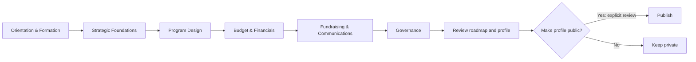

# Workspace AI, Accelerator graphs and credits

Date: 2026-10-22. **Implementation in progress; commercial policy remains proposed.**

Authoritative checkpoint for this planning slice. Companion: [rewritten prompt](2026-10-22-workspace-ai-prompt.md).

## 1. Recommendation and scope

Build one bounded AI layer inside the current workspace. Reuse the canvas, document editor and saved-data owners. AI suggests; people approve changes; deterministic code enforces permissions, curriculum rules and money.

The first usable slice is: **select a core document → ask for help in the composer → see a streamed proposal and its credit cost → accept into the existing editor → save and reopen it.** This proves the same foundation later used for decision trees and resource matching.

| Approach | Trade-off | Decision |
| --- | --- | --- |
| AI SDK plus selected shadcn chatbot patterns inside Coach House | Reuses streaming/tool UI while retaining our data and design contracts | Recommended |
| Direct OpenAI SDK with custom chat transport | Fewer new packages; more streaming, typed-message and tool-state work | Viable fallback if compatibility fails |
| Replace workspace with a standalone chatbot/agent application | Duplicates navigation, persistence and permission boundaries | Reject for this scope |

The supplied framework asks for depth: the critical work is trustworthy state changes, correct billing and evidence-backed outputs, not a larger agent platform. Instinct, new external connectors, autonomous applications/outreach, image/audio generation and broad nonprofit acquisition are deferred.

### Evidence and authority

Inspected source at `5644ccc34cbbfc7ed3b94e77d409e4e12c0202e4` on `feat/particle-system-20261009`, initially clean and tracking its matching remote branch. The main checkout is a different worktree; it is not the implementation target. Original workstream08 is background context; this newer request selects planning in the existing redesign lane instead of its old isolated-main implementation sequence. Shared SHIP records and other lanes remain unchanged.

Inputs: the supplied framework, all six screenshots, the complete two-version curriculum text, current code, original packet 08, existing Particle/Workspace Engine/objective plans and current official provider documentation. Earlier plans contain historical architecture and interaction details; current source and newer user directions take precedence.

No boards were cleared, runtime code changed, services purchased or production data modified. The separate Brand Identity migration remains pending its own approval; this plan does not apply it.

## 2. Existing system and integration points

| Area | Verified current source | Planned reuse / missing piece |
| --- | --- | --- |
| Composer | `src/features/workspace-particles/components/particle-composer.tsx` | Search/create parser exists; conversational AI does not |
| AI | `src/app/api/ai/sql/route.ts`; `openai` dependency | Management SQL generation only; never expose its privileges to members |
| Canvas | `src/features/workspace-particles/lib/{particle-schema,graph-operations,graph-validation,graph-layout,particle-decision}.ts` | Typed particles, decisions, operations, replay receipts and validation; add reviewed AI proposals |
| Board saves | `src/app/(dashboard)/my-organization/_lib/workspace-board-state-write.ts` | Preserve compare-and-swap and named-workspace merging |
| Accelerator | `src/features/workspace-accelerator-card/{types.ts,lib/checklist.ts}` | Existing module/step state and embedded lesson navigation; add curriculum graph projection |
| Objectives | `src/features/workspace-objectives/types.ts`; `src/app/(dashboard)/my-organization/_lib/workspace-objectives-actions.ts` | Existing relational groups, objectives, assignments and links; reconcile numeric particle state |
| Documents | `src/features/document-editing/**`; `src/components/roadmap/**`; `src/components/rich-text-editor.tsx` | Existing room permissions, Tiptap/Yjs and save/recovery contracts; adapters differ by document type |
| Opportunities | `src/features/workspace-finance/{types.ts,lib/opportunity-ingestion.ts,server/opportunities.ts}` | Existing opportunities lack the complete amount/eligibility/evidence/resource-match model |
| Billing | Existing Stripe checkout/webhook and coaching ledger | Reuse payment/session conventions; add a separate AI ledger and reservations |

Current package declarations include Next 16.4, React 19.2, React Flow 12.12, Tiptap 3.16, Zod 4, OpenAI 6.25 and Stripe 18.5. No `ai`/`@ai-sdk/*` packages are installed. Confirm lockfile compatibility at implementation, without upgrading the app framework incidentally.

### shadcn chatbot template

Use its typed message-part rendering, streaming status, `ask_user` questionnaire and source-list pattern. Preserve the MIT notice for copied source. It is a useful reference, not a replacement app. [Template](https://github.com/shadcn-ui/chatbot-template)

The inspected manifest uses AI SDK 7, `@ai-sdk/react`4, `@shadcn/react`, Base UI, React 19.3 and Next 16.3.6. Adapt needed primitives to our established components; verify peer dependencies and pin a reviewed revision. Do not copy its package file or globally replace Radix-based controls. [Manifest](https://github.com/shadcn-ui/chatbot-template/blob/main/package.json)

Its chat route validates messages and bounds model steps/output but is public and has no Coach House billing or organization authorization. Build our route around those missing controls. Do not inherit demo tools, arbitrary model selection or unrestricted reasoning displays. Show concise work status and evidence instead. [Route](https://github.com/shadcn-ui/chatbot-template/blob/main/app/api/chat/route.ts)

AI SDK is the application toolkit; AI Gateway is optional provider routing/billing infrastructure. Neither supplies our customer wallet. Start with one provider behind the SDK; evaluate Gateway only against actual routing, retention and cost needs. Current official SDK documentation is v7. [AI SDK](https://ai-sdk.dev/docs/introduction)

## 3. User journeys and UI

### Composer and documents

Keep the current bottom composer and existing window convention. Deterministic search/add commands remain free. Provide an explicit AI action/mode so ordinary library searches do not unexpectedly spend credits. Show removable context chips for the selected organization, resource and document/selection. Private files are included only after authorization and deliberate selection.

1. User opens a document or selects a resource and asks a question.
2. Composer shows relevant context and a maximum credit charge before a metered run. One compact clarifying question appears only if the target or needed facts are missing.
3. Stream into a draft preview, not the live document or graph. Show Stop and a stable status; do not shift the whole canvas on each token.
4. Offer Apply, Revise and Discard. For document changes show target, insertion/replacement scope and comparison. Applying without another generation costs no additional credits; Revise is a new priced run.
5. Apply through the document's real editor transaction and save contract. Show Saved only after canonical acknowledgment. Reopen proves persistence.

Start with core documents already edited in the workspace. Expand to notes and supported uploaded documents only through their own adapters. Do not claim unsupported Google Drive editing. Recheck target permission and version on Apply; a changed document produces a comparison/review state, never a silent overwrite. Generated content stays private/draft and uses existing sanitization. In collaborative editors, use native editor transactions, not whole-document HTML replacement.

### Shared states

| State | User behavior |
| --- | --- |
| Empty | Small task suggestions tied to selected context; no invented organization facts |
| Working | Clear bounded status, streaming preview and Stop |
| Clarification | One concise question; resume same run/context with validated answer |
| Ready | Review proposal, sources, cost and affected target |
| Stale/conflict | Preserve proposal and current edits; compare or regenerate |
| Insufficient credits | Preserve input; show remaining balance, reset date and permitted purchase action |
| Failed/interrupted | Retain draft/input; show final charge or pending reconciliation; retry with an explicit new request |
| Permission changed | Stop reading/applying protected content; preserve only what the user may still access |

Use the app's compact rounded cards, pills, restrained borders and light/dark/system tokens. Avoid extra explanatory boxes. Keep keyboard focus visible only when appropriate, touch targets 44px, contextual actions labeled, and live announcements restrained. Honor existing pan/Shift-selection behavior. Motion uses existing transform/opacity transitions, supports interruption and reduced motion. Provide a keyboard-accessible list equivalent to graph navigation. User visual review precedes visual-baseline updates.

## 4. Optimized Accelerator graph

The curriculum is deterministic, versioned content. AI may explain or recommend a next step; it cannot rewrite required questions or infer completion.

| Stage | Groups | Lessons | Questions |
| --- | --- | ---: | ---: |
| Orientation & Formation | Introduction; Formation | 5 | 0 |
| Strategic Foundations | Strategic Foundations; Mission, Vision & Values; Theory of Change & Systems Thinking | 9 | 91 |
| Program Design | Piloting Programs | 4 | 20 |
| Budget & Financials | Budgets; Intro to NFP Financials | 6 | 13 |
| Fundraising & Communications | Fundraising; Communications | 11 | 58 |
| Governance | Boards that make a difference | 6 | 4 |
| **Total** | **11 groups** | **41** | **186** |

Retain all 28 question-list and 20 output-list cards. Questions and input types come unchanged from Version 1, nested by Version 2's order. The Markdown lacks stable IDs and a complete machine-readable output mapping: reconcile it with the original flow export and current assignments before generating a manifest. Fail the reconciliation on missing/duplicate IDs; do not fuzzy-match titles into silent writes or add hidden lessons to this 41-lesson view.

Default canvas: six compact stage cards. Expand a stage to groups/lessons; expand a lesson to question/output cards. Open content in the existing workspace window. Collapse only hides a projection, preserving records, answers, edges, completion and drafts. Keep expansion/viewport preferences personal; changes by another collaborator must not collapse a user's active editor. Re-layout only the affected managed region and discard stale worker results.



Arrows above show suggested learning order, **not access locks**. Entry is the current paid-member signup/workspace/profile journey; do not restore removed intent/community onboarding steps.

| Relationship | Meaning |
| --- | --- |
| Contains | Stage/group/lesson hierarchy |
| Suggested next | Recommendation; user may skip/open other lessons |
| Updates | Existing explicit answer-to-profile/roadmap mapping |
| Related | Reference only; no automatic save |
| Decision outcome | One declared outcome chosen by the user/rule |
| Dependency | Genuine, separately defined requirement |

Current graph relationships do not express all these distinctions. Add a versioned projection/adapter instead of encoding curriculum order as blocking dependencies. Need Statement, Mission, Vision, Values, Theory of Change and pilot mappings must retain their existing authoritative save rules. Publishing remains separate from lesson completion.

### Safe board adoption

First preview with fictional local fixtures and a new development workspace. New-user starters can later use the versioned template. Existing users get an opt-in preview with a recoverable layout snapshot and retained IDs; adoption changes presentation without deleting underlying lessons, documents, custom resources or named workspaces. A future destructive replacement requires a separately reviewed exact scope. Rollback restores layout without rolling back legitimate intervening answers/document edits. Unknown schema data is preserved, never normalized into an empty board.

## 5. Decision trees and objective tracker

### Decision trees

Example user intent: “Help plan funding for our summer pilot.” AI asks for missing target/context, then proposes a small graph with decisions, named outcomes, resources and next actions. Every consequential conclusion includes supporting facts or a visible assumption. An unknown fact produces “Needs information,” not an invented answer.

Return a bounded structured proposal: node type/title/context references, declared decision outcomes, typed edges, source IDs and explanation. Server assigns/binds IDs and checks schemas, cross-org references, cycles, limits and permissions. No arbitrary JavaScript predicates, SQL, executable components or model-directed network destinations. Current decision outcomes do not constitute a generic rules engine. Add only a small typed predicate vocabulary if an approved slice needs automatic evaluation.

Preview proposed changes before accepting an atomic operation batch through existing graph writers. Persist application idempotency beyond the graph's 64-entry replay receipt window. Retry does not duplicate cards; undo does not overwrite someone else's subsequent work. AI generation never marks a lesson complete or sends an application. Start with one authoritative target per proposal. If a later proposal spans objective records and graph projections, use an authorized transactional command or durable reconciliation state; do not claim atomic success across unrelated writers after a partial save.

### Objective tracker PRD

**Outcome:** users know their next action, its owner and why it matters, while distinguishing learning progress from real organizational results.

Compact view: title, status, owner, due date, linked resource and a truthful progress indicator. Detail in the existing window: desired outcome, target/current/unit, milestones, evidence, source document/lesson, dependencies and history. Filters: workspace/resource, mine, due soon, blocked, completed. Open lesson links inside the workspace rather than navigating away.

Use current relational objective IDs/groups/assignees/source keys as canonical task identity. Reconcile particle target/current/unit into that model with additive metric/history fields; particle cards become projections referencing those IDs. Do not create a third objective store. Existing source keys prevent duplicate derived tasks. Completion comes from current source rules or an explicit permitted user action, not from reading a lesson, accepting AI text or elapsed time.

Keep three kinds of progress distinct:

- Learning: completed applicable lessons/steps, using existing rules.
- Work: completed milestones/total applicable milestones.
- Outcome: evidenced current/target in the same unit; no percentage when target is missing/zero.

Funding examples show potential, awarded/committed and received separately. An opportunity being saved or applied to changes workflow status, not money received. Deduplicate linked awards before aggregation. AI can propose a milestone breakdown; user acceptance creates records once.

## 6. Resources and opportunity matching

Rename workspace labels **Activity → Resource**, **Activities → Resources**, **Add activity → Add resource**, including menus, library, search hints and accessible names. Keep stored `activity`, UUIDs, `activityId`, widget storage and API contracts initially. Preserve genuine audit/activity-history language and distinct public resource-directory terminology. Add “activity” search aliases for older users. A storage rename would be a separate versioned migration.

### Card and detail

Adapt image 1: compact fit strip, amount/range, title, two-line summary, provider/location, deadline and a few useful tags. Save and dismiss controls have accessible names and undo. Detail exposes “Why this fits,” unmet/unknown criteria, source, last verified date and the target resource. Save is not Apply; preparing an application opens a draft workflow, never submits it.

Use qualitative fit labels initially. A future numeric fit score requires a documented rubric and calibration; it must never be labeled as probability of winning. Deterministic eligibility is pass/fail/unknown for each published criterion. AI may extract candidate facts and explain them; missing facts remain unknown.

### Dollar-value contract

Always attempt value resolution in this order: structured award fields → original notice/attachments → funder's official page. Cap retrieval effort and report missing values honestly.

| Evidence | Display / calculation |
| --- | --- |
| Published per-award amount/range | Show currency, bounds, period and source |
| Published maximum only | “Up to $X”; never present it as expected proceeds |
| Total funding pool | Label as program total; do not imply it is one applicant's award |
| In-kind quantity with defensible value source | Show quantity; optional cash-equivalent estimate with method/date/source, separately from cash |
| No reliable amount | “Amount not published”; retain source and verification date |
| Resource need/budget missing | Ask for target/remaining need; do not invent a funding gap |

For comparable currency/period and eligible costs, `potential_coverage_max = min(published_per_award_cap, eligible_unfunded_resource_cost)`. A published minimum exceeding the user's eligible request may mean ineligible; do not silently clip it. Account for restricted costs, matching-fund requirements, cost share and overlap. Example fixture: a $25,000 eligible unfunded pilot and an award of up to $10,000 can show “Up to 40% of this gap,” not “$10,000 secured.” Foreign currency requires a dated rate/source or stays in source currency. No expected-value multiplication by an uncalibrated fit score.

### Data and sources

Extend existing opportunities with canonical provider/external ID, original URL, posted/updated/discovered/verified times, deadline/timezone, status, award floor/ceiling/currency/period, funding pool, cost-share rules, eligibility facts and field-level evidence. Store per-resource matches separately with resource revision, criteria outcomes, explanation, value calculation and ranking version. Deduplicate by provider ID and canonical notice; distinguish amendments from new awards. Private organization matching data stays private.

Start with a bounded US pilot using official grant sources and user-supplied funder URLs. Grants.gov search plus detail APIs expose opportunities and award fields; federal coverage alone is not a comprehensive local-foundation feed. Add other official funders only with supported access and provenance. [Grants.gov search](https://www.grants.gov/api/common/search2), [opportunity detail](https://www.grants.gov/api/common/fetchopportunity)

Simpler.Grants.gov also offers search/detail access; it currently documents read-only APIs. Compare its schema/access and duplication with Grants.gov before choosing one primary adapter, rather than ingesting both as separate awards. [Developer documentation](https://simpler.grants.gov/developers)

“Last 7 days” means source posted/updated time, with discovered time stored separately. Refresh before applying; flag stale or withdrawn results and exclude expired opportunities from active matches. Start on demand; scheduled feeds/notifications require a later explicit user-facing subscription and budget policy.

## 7. Runtime and persistence contract

```mermaid
sequenceDiagram
  participant U as Workspace user
  participant A as Authorized AI service
  participant L as Credit ledger
  participant M as Model/tools
  participant W as Existing writers
  U->>A: Intent + allowed target IDs + request ID
  A->>A: Resolve actor, org, permissions, revisions
  A->>L: Reserve bounded maximum atomically
  A->>M: Limited context and allowlisted tools
  M-->>U: Draft/status through validated stream
  M-->>A: Final output and usage
  A->>L: Settle once; release unused reservation
  A-->>U: Validated proposal + sources + actual charge
  U->>A: Apply proposal
  A->>A: Reauthorize + verify source revisions
  A->>W: Idempotent domain operation
  W-->>U: Saved version/operation receipt
```

New feature boundaries: `workspace-ai` for runs/context/tools/proposals; separate `ai-credits` for accounting/payment policy. Scaffold only when implementation begins. Reuse existing objective/finance features and add a curriculum projection within the Accelerator feature. Routes remain composition-only.

Private records needed: AI runs, bounded messages, proposals, billing accounts, grants/purchase lots, reservations and append-only ledger entries. Run metadata includes actor/org/workspace, request ID, input revisions, task/model, policy version, usage/cost, proposal and operation receipt. Strict RLS plus server authorization; organization context is never trusted merely because the client or model supplied it. Do not place private context or drafts in public profile JSON.

Use AI SDK `useChat`/streaming and schema-validated structured output, followed by domain validation. Partial streamed objects are never valid mutations. Rehydrate server-owned messages and validate tool parts; do not accept fabricated tool output from arbitrary client history. [Message persistence](https://ai-sdk.dev/docs/ai-sdk-ui/chatbot-message-persistence), [structured outputs](https://ai-sdk.dev/docs/ai-sdk-core/generating-structured-data)

Initial tools are read-only scoped context/retrieval and proposal builders. Tool calls reauthorize each target. Retrieved content is untrusted evidence, never permission to execute instructions. Prevent SSRF with constrained sources, redirects, response limits and timeouts. Provider keys remain server-only; do not log raw private document bodies by default. Adopt a documented retention/deletion period before rollout and delete derived context when its source/access is revoked. Provider retention/training settings must be verified for the chosen endpoint/account.

Cancellation aborts the initial bounded request where possible; durable run records own reconciliation. Do not mix abort semantics with resumable streaming without an explicit later design—the SDK documents their incompatibility. A browser disconnect does not prove that provider spend stopped. [Stopping streams](https://ai-sdk.dev/docs/advanced/stopping-streams)

No vector database is necessary for the first selected-document slice. Begin with permission-filtered structured records and bounded document context. Add retrieval indexing only when measured task needs justify it; never index private content into a shared public corpus.

## 8. Credits, allowances and economics

All numbers below are **launch proposals**, not current entitlements or approved prices. Current source lists Organization at $20/month and Operations Support at $58/month in `src/components/public/pricing-surface-data.ts`; live Stripe catalog/invoices were not audited. Coaching credits remain a separate product and ledger.

### Proposed policy

| Item | Starting proposal |
| --- | --- |
| Credit unit | 1 credit has $0.01 purchase value; not a token or a cash-withdrawal balance |
| Usage tariff | `ceil(total billable provider cost in USD / 0.002)` credits per run; versioned rate card |
| Organization plan | 500 credits/month; at most $1 normal billable provider cost |
| Operations Support | 1,500 credits/month; at most $3 normal billable provider cost |
| Free accounts | No recurring AI grant initially; ordinary workspace operations remain usable |
| Packs | $10/1,000; $20/2,000; $50/5,000 credits |
| Reset | Included credits refresh monthly without rollover; purchased lots persist |
| Spending order | Included expiring credits first, then purchased credits; reservations retain exact lot allocation |
| At exhaustion | Stop new metered work; preserve drafts and allow ordinary editing; show reset/purchase options |
| Auto-refill | Off by default; explicit billing-owner consent and monthly cap |

**Billing owner:** one paid subscription funds one designated organization's wallet, shared by authorized members across its workspaces. Existing personal subscriptions need an explicit subscription→billing account→organization binding; neither creating a workspace/org nor inviting a member creates another grant. Never assume active-organization switching moves balances. Allocation changes take effect next period after review and cannot duplicate grants. Members with their own paid accounts do not silently pool balances. Owner/billing-authorized roles buy credits and set caps; editors can consume within assigned limits; viewers cannot run mutating AI tasks.

Grant once per verified paid entitlement period with a unique subscription/period key. Do not use broad UI “paid-like” checks—current code can treat `past_due`/`incomplete` as paid-like. Define annual-plan monthly grant scheduling, prorated upgrade grants and discount/comped entitlement policy before launch; never issue twelve monthly grants on one annual webhook. A failed renewal creates no fresh grant. Cancellation stops future grants at entitlement end; purchased balances remain visible and usable subject to normal account access, without requiring renewal. Deletion/refund treatment must be disclosed before selling. These business defaults need signoff.

### Price evidence and model routing

Official standard rates checked 2026-10-22:

| Candidate | Input /1M tokens | Cached input /1M | Output /1M | Intended evaluation |
| --- | ---: | ---: | ---: | --- |
| GPT-6 Luna | $0.10 | $0.01 | $0.50 | Extraction, short classification and simple assistance |
| GPT-6.1 Sol | $2.00 | $0.10 | $10.00 | Substantive writing and decision proposals |

Web search is $0.01/call plus retrieved input tokens. Hosted file search has call/storage charges. Use standard service tier initially; premium tiers, long-context surcharges, caching writes, provider/Gateway fees and other tools must enter the rate card when enabled. Record all billable output, including reasoning, and every tool/model step. [OpenAI pricing](https://developers.openai.com/api/docs/pricing)

Model names are candidates, not a quality guarantee. Evaluate against real task fixtures before selection; keep allowed models server-controlled. Do not include cost-saving batch/caching assumptions in the launch allowance until measured.

`provider_cost = uncached_input × rate + cached_input × rate + billable_output × rate + tool_calls + applicable service/storage fees`

Use integer microdollars and integer credits. Record immutable tariff/model/price versions. Reserve the quoted maximum before any provider call; settle measured usage once. Hidden internal repair calls stay within the quoted run maximum; never exceed it without a new explicit continuation. Failed work can still cost Coach House money even when the user is not charged, so enforce provider budgets independently of the customer ledger.

### Illustrative workload envelopes

These are modeled typical/high cases, **not measured p50/p95**. Input includes retrieved context; output includes reasoning. No cache discount. One run's entire tool/model budget must fit the envelope.

| Sol task | Typical input/output; searches | Provider cost | Credits | High input/output; searches | Provider cost | Credits |
| --- | --- | ---: | ---: | --- | ---: | ---: |
| Document draft | 6k/1.5k; 0 | $0.027 | 14 | 24k/8k; 0 | $0.128 | 64 |
| Decision tree | 6k/3k; 0 | $0.042 | 21 | 40k/12k; 0 | $0.200 | 100 |
| Opportunity matching | 10k/1.2k; 3 | $0.062 | 31 | 48k/6k; 6 | $0.216 | 108 |

500 credits could cover about 35 typical drafts, 23 typical trees, or 16 typical matching runs if spent only on that task. Those are examples, not fixed usage promises. A mixed month of 20 drafts + 5 trees + 5 matching runs uses 540 credits/$1.06 provider cost; the high envelopes use 2,320 credits/$4.64. Ordinary typing, reading, saving accepted content, manual graph work and cached result viewing cost zero AI credits.

At full redemption, the 500-credit grant plus an illustrative 25% variable operating allowance costs $1.25, or 6.25% of a $20 subscription. The 1,500-credit proposal similarly models $3.75/6.47% of $58. This is incremental AI cost only; it does not establish overall subscription profitability or account for support-heavy use.

| Pack | Provider-cost ceiling | Card fee assumption | Variable operating allowance | Modeled contribution |
| --- | ---: | ---: | ---: | ---: |
| $10 | $2.00 | $0.59 | $0.50 | $6.91 /69.1% |
| $20 | $4.00 | $0.88 | $1.00 | $14.12 /70.6% |
| $50 | $10.00 | $1.75 | $2.50 | $35.75 /71.5% |

Card assumption is Stripe's published US domestic-card 2.9%+$0.30; actual account/payment-method rates may differ. Operating allowance is hypothetical. Contribution excludes fixed engineering/support, tax, disputes, refunds, FX and additional processor products. [Stripe pricing](https://stripe.com/us/pricing)

If actual provider cost doubles while an outdated tariff still debits the original credits, the $10 pack's modeled contribution falls to 49.1%; at 3× it is 29.1%. Keep rates versioned/current, alert on reconciliation drift and reprice prospectively with visible estimates. A cost-indexed tariff raises credit consumption when underlying rates rise; communicate that explicitly. Never retroactively change completed charges or quietly switch a run to a more expensive model/tier.

### Accounting and failure rules

Run states: created → reserved → running → succeeded/failed/canceled → settled; ambiguous provider outcomes enter reconciliation. Proposal application has its own independent state/idempotency key.

- Ledger entries are append-only. Derive available balance from valid grants/purchases minus settled debits and active reservations; lock/serialize wallet changes in PostgreSQL. Expired grants with in-flight reservations require explicit settlement rules, not blanket deletion.
- One active run per user, three per organization initially. Bound input, output, tool calls, elapsed time and provider cost per task. Enforce configurable member spending caps, wallet caps, global daily provider budget and kill switch. Global admission includes the worst-case cost of in-flight runs and absorbed failures, with provider-side spend limits as a backstop. Fail closed if accounting is unavailable.
- Quote expected credits plus a hard maximum. Settle a successful usable result even if the user discards it; generation did occur. Apply does not charge again. Regenerate/Revise starts a disclosed new charge.
- Failure with no usable result releases user credits; Coach House absorbs verified provider cost. Initial cancellation policy: no user charge until a complete usable artifact is delivered; Stop releases unused customer reservation after provider reconciliation. Repeated abort abuse is rate-limited, not silently billed differently.
- SDK automatic continuations/internal retries share the run budget. An uncertain timeout is not a safe reason to launch duplicate provider work. Reconnect reads the existing run. Unknown usage holds a bounded reservation until a reconciliation worker resolves it; support can issue an audited adjustment, never edit history.
- Every grant, reservation, settlement, release, purchase, refund and adjustment has a unique business-operation key. Test duplicate calls after process restarts and expired graph receipts.

### Purchases and auto-refill

Server chooses product/price/credit quantity and binds an order to its billing account, org, currency and Stripe mode. Credit only after verified successful payment, deduplicated by payment identity as well as webhook event. Checkout return is a status page, not payment proof. [Stripe webhooks](https://docs.stripe.com/webhooks)

Suggested opt-in: **buy $10 when available credits fall below 100; maximum $30 in refills per calendar month**. Show timezone/reset, payment method, exact amount, pending refill and Disable. Count pending charges toward the cap; lock one refill intent per wallet and use stable provider idempotency. Trigger from real wallet activity, not repeated page loads. Failed/authentication-required charges pause auto-refill and offer an explicit recovery action. Never blindly retry or silently increase the cap. [Stripe idempotency](https://docs.stripe.com/api/idempotent_requests)

Obtain explicit off-session consent and a compatible payment setup; use SetupIntent or appropriately configured Checkout. Payment options depend on the configured Stripe account/browser, not the screenshot. Refills become credits only after success. [Setup Intents](https://docs.stripe.com/payments/setup-intents)

Refunds/disputes append compensating entries, freeze unspent refunded lots and prevent repeat credit. Already-consumed refunds need a defined review/debt policy without corrupting the ledger; this is a launch decision, not an improvised webhook action. Avoid showing a refund as completed until Stripe confirms it.

## 9. Usage and billing UI

Use images 2–6 as hierarchy references: a compact Usage navigation item; an overview with plan, balance/reset and history; a separate purchased-credit area; package selection and clear checkout total. Do not copy ChatGPT branding, weekly limits, prices, custom-amount complexity or unsupported payment methods.

Overview shows included remaining/total and reset date, purchased balance, temporarily reserved credits and total available. The compact percentage refers only to the included allowance; mixed purchased/included balances need an absolute available count so a purchase cannot misleadingly show more than100% remaining. Provide per-run date, actor, task, resource, status and actual credits, with context links only where access is allowed. Billing owners can filter member usage and set caps; raw private prompts are not needed in financial history.

Purchase flow: choose one of three packs → see exact credits/price/taxes → Stripe checkout → pending/success/failure status → refreshed server balance. Auto-refill stays separate and opt-in. A member without billing permission sees usage and a clear owner action path, not a working purchase button. Analytics can initially be a compact task/member summary, not a new dashboard suite.

## 10. Delivery sequence and acceptance

Each phase ends with a complete usable interaction; no provider spend is exposed before metering. Use flags default-off and local/test fixtures before any production adoption.

| Phase | Deliverable | Required evidence |
| --- | --- | --- |
| 0. Contracts and fixtures | Stable curriculum ID map; objective ownership decision; approved billing policy; small representative document/tree/match fixtures | 41 lessons/186 questions/28 question lists/20 output lists reconciled; proposed dollar claims reviewed against sources; exact affected records known |
| 1. Metered document assistance | Authenticated composer → draft → review → existing editor apply/save; private runs and wallet reservation/settlement; Usage overview | Cross-org denial, concurrency/no overspend, cancellation/retry, sanitization, stale-document handling, collaboration and save/reopen pass |
| 2. Purchases and refill | Three packs, verified fulfillment, opt-in capped refill, owner/member controls | Stripe test-mode success/delay/failure/SCA/refund/replay/out-of-order tests; pending-cap races; grant renewal and multi-org duplication tests |
| 3. Accelerator and objectives | Versioned six-stage expandable graph, canonical objective projection, in-window lesson/document links | Existing progress/answers preserved; no accidental prerequisites; collapse/reload/focus, source completion and narrow/wide layout review |
| 4. AI decision proposals | Intent → clarification → typed graph preview → apply/revise/discard | Invalid/dangling/cyclic/cross-org operations rejected; idempotent apply/undo; collaboration and locked/manual layout preservation |
| 5. Resource opportunity matching | Selected resource → bounded official retrieval → evidence/value cards → saved detail/application draft | Eligibility/unknown/expired/duplicate/award-range/total-pool/in-kind fixtures; explainable relevance; saved matches never increment secured funds |
| 6. Controlled rollout | Allowlisted organizations, observed cost/quality, explicit workspace adoption and rollback | Current-revision required CI/review, user acceptance, telemetry and provider reconciliation; exact migration approval/readback separately |

Phases 3 and 4 may share components, but do not implement a second graph engine. Public-source retrieval is initially on demand. The generic objective engine, documents and curriculum remain usable when AI is disabled or unavailable.

### Evaluation and release gates

Before model selection, build a small adjudicated fixture set spanning short/long documents, missing/conflicting context, valid/invalid tree requests and grants with known eligibility/amounts. Use real de-identified or consented material; fictional fixtures stay labeled and out of public feeds. Version prompts/models/rates and source snapshots for reproducibility.

Proposed release thresholds: zero cross-tenant access, overspend, duplicate credit, destructive overwrite or unsupported public-dollar claim in the release suite; 100% curriculum ID coverage; all accepted graph proposals pass deterministic validation. Human reviewers score usefulness, source faithfulness and appropriate uncertainty; choose a target acceptance rate only after establishing a baseline. Measure p50/p95 provider cost and latency per task and cost per accepted useful artifact, including retries and absorbed failures. Do not market modeled envelopes as measured outcomes.

Focused checks cover changes during development. RLS/SQL concurrency tests are mandatory for wallet/data changes. User reviews appearance and actual journeys. Required hosted `quality`, code-owner review, branch protection and relevant visual baselines remain release gates; broad local suites are not run just for reassurance. No production migration, billing product creation, live charge, board reset or deployment is authorized by this plan.

### Business decisions before launch

1. Approve/revise 500/1,500 monthly allowances, the cost-indexed rate card and packs after measured evaluations.
2. Confirm subscription-to-organization binding, member limits, comped/annual/upgrade/cancellation/refund policies.
3. Approve the initial geography/source set; US federal plus user-supplied official sources is the proposed bounded pilot, not comprehensive funding coverage.
4. Set private chat/context retention and verify provider processing settings; choose direct provider or Gateway based on those constraints.
5. Review opt-in template adoption and exactly which development workspace may be reset when implementation starts.

These do not block completing this plan. They block committing corresponding commercial or production behavior.

## 11. Planning verification and continuation

Completed source inspection and three independent research reviews: architecture/template fit; credit economics; optimized curriculum/objectives/opportunity UX. All six user images inspected. Current rates and API/template docs checked on 2026-10-22. No runtime tests or live-account audits are claimed for this documentation-only task.

Planning checkpoint `4ac8e089687259bd314365603a056a7606798e8d` was pushed to the existing development branch; independent `git ls-remote` matched and the checkout was clean. `git diff --check`, relative-link/fence checks, curriculum totals, six cost/credit examples and mixed-month arithmetic passed. Normal Node22 pre-push supply-chain, file-size and lint stages passed. Later independent follow-up review calls hit model capacity; the initial three research reports completed and the final synthesis was reviewed locally.

Graphify AST refresh completed; the changed canonical index received a separate semantic refresh. Final local graph:22,712 nodes/66,723 edges. Three pre-existing test parser warnings and unrelated historical semantic backlog remain; neither is an application-test result. Recovery log: `/tmp/workspace-ai-plan-graphify-20261022.log`. Plans/runlogs are excluded by the existing Graphify scope. No runtime source changed.

Next implementation step: phase 0, then a metered selected-core-document vertical slice. Preserve the existing branch and current application; do not resume unrelated old checklists, apply the pending Brand Identity migration or clear user boards from this planning handoff.

## 12. Active implementation checkpoint — 2026-10-22

The user activated the complete implementation goal. This section is the authoritative continuation record; section11 describes the earlier planning checkpoint. Work remains on `feat/particle-system-20261009` in the existing particle-system checkout. No production migrations, grants, charges, board resets, main merges or deployments have occurred.

### Implemented in the first development slice

- Scaffolded `workspace-ai` and `ai-credits`. The existing composer gains an explicit AI mode, a server-quoted maximum, bounded streaming preview, original comparison, Apply, Stop, usage and status recovery. Normal commands remain free. UI and server flags default off; database policy and organization wallet must also explicitly allow use.
- Reused the installed OpenAI Responses SDK with typed stream parts and bounded requests, retaining the template's stream/review/stop pattern without copying its dependencies or replacing existing primitives. No framework upgrade or new package installation. Tariffs are server-configurable/versioned; proposed defaults do not grant entitlements.
- Core-document access is verified against the current authenticated organization and storage permission. Context comes from the canonical saved document. Drive-backed, budget and calendar documents are not falsely presented as supported text editors.
- Applying checks mounted-editor scope, baseline revision and unsaved changes, then uses its existing draft/autosave/CAS path. AI drafts retain private-save intent through local recovery, save as Draft and do not publish. Saves preserve typing that arrived while an earlier save was in flight.
- Local migrations add private, RLS-protected wallets/lots, immutable entries/allocations, durable runs, serialized reservations, one-run-per-actor and organization/global/member caps, cost settlement, replay identity, read/status and durable cancellation. No session/anonymous financial writes or private table reads. Stop before settlement releases the customer charge while retaining measured provider cost. Unknown provider outcomes retain reservations instead of automatically retrying/spending twice.
- UI follows `docs/design.md` neutral surfaces, restrained borders, existing rounded/pill controls, light/dark tokens and coarse-pointer targets. Streaming uses a fixed-height preview; no token-by-token canvas resize.

### Evidence and limits

- Node22 focused Vitest run:29 tests passed across `ai-credits`, `workspace-ai`, `workspace-ai-editor`, `core-document-source-action` and `roadmap-editor-status`. Covers pricing, access/price denial before spend, replay, sanitization, partial/unknown usage, editor conflict checks and private draft reload.
- `node supabase/tests/workspace-ai.test.mjs` passed against a disposable local PostgreSQL server. Exercises private access denial, duplicate reservation/settlement/payment keys, expired-lot exclusion, cancellation, daily budget enforcement and a real two-connection overspend race. The harness stops and removes only its own temporary database.
- Focused lint, import boundaries and diff checks pass. Feature-contract check reports three pre-existing violations in workspace-particles/workspace-sharing, none in the new features. Whole-repository TypeScript still reports existing workspace-management/calendar/public-map test errors; no new-feature errors were reported in `/tmp/workspace-ai-types-final-20261022.log` at that check's revision. Do not describe the whole repository as type-clean.
- Provider behavior is tested with a mock; no paid provider evaluation, authenticated browser save/reopen, production schema application or user visual acceptance is claimed. Visual baselines await actual appearance review. AI remains disabled.

### Next work — phase1 is NOT complete

1. Complete durable crash/timeout reconciliation, persist provider request correlation before output, and establish a bounded recovery path for unresolved provider usage without duplicate calls or unreviewed retention changes. The current status UI exposes reconciliation, but no reconciliation worker/operator resolution path exists yet.
2. Finish per-target apply/save receipts and verify save/reopen plus concurrent editor behavior end-to-end. Review original/proposal comparison, explicit Revise behavior, context switching, quota freshness, expired-but-reserved balance presentation and recovery UX. Existing core documents use their CAS owner; uploaded-document Yjs adapters remain a later supported-target integration.
3. Add an isolated local/test fixture that can demonstrate the enabled interaction without using production data or live billing. Obtain user appearance review before updating visual baselines. Do not enable this on the shared production-connected preview as a shortcut.
4. Then proceed through purchases/refill, curriculum/objectives, decision proposals, resource matching/terminology and controlled-release evidence. All original scope and production approval boundaries remain in force; the initial slice is not goal completion.

Pending local AI migrations: `20261022120000_workspace_ai_metering.sql` and `20261022121000_workspace_ai_read_and_recovery.sql`. The unrelated Brand Identity migration remains separately pending. Activation requires `NEXT_PUBLIC_WORKSPACE_AI_ENABLED=true`, server `WORKSPACE_AI_ENABLED=true`, a provider key, and explicit database policy/wallet enablement. `WORKSPACE_AI_RATE_CARD` can override the proposed server tariff with validated JSON. No activation has been performed.
